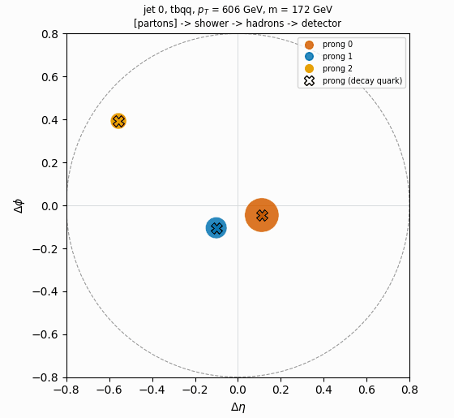
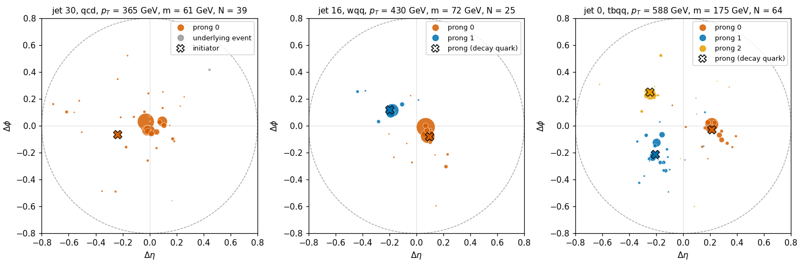
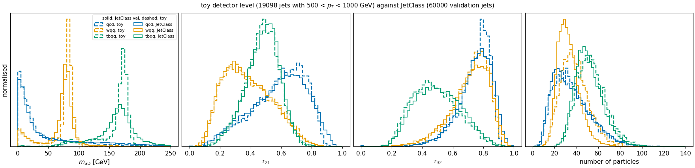

# inside-the-jet

[](https://github.com/hqucms/inside-the-jet/actions/workflows/ci.yml)
[](https://www.python.org/downloads/)
[](LICENSE)
[](https://github.com/astral-sh/ruff)

**Representation learning and interpretability for jet tagging**, built up from a toy whose truth we know. At the
Large Hadron Collider (LHC), quarks, gluons and the decays of fast W bosons and top quarks show up as jets: collimated
sprays of tens of particles. A jet tagger is a classifier that reads these particles and tells what started the jet.
The best taggers today are graph networks and transformers (neural networks that take a whole set of particles as
input; see the [ML primer](docs/ml_primer.md#networks-on-particles)), trained on millions of jets. This project asks
what such taggers learn and how to check it.

It starts with **A Spray of Hadrons**, a jet generator written from first principles. It simulates the life of a jet in
five stages. The hard process is the collision that makes the quark, gluon, W or top. In the parton shower, the quark or
gluon splits again and again. In hadronisation, the pieces bind into hadrons. The underlying event adds soft particles
from the rest of the collision. Last comes a simple detector. The [primer](docs/primer.md) explains each step. Its files
have the branches (named columns) of the JetClass data set, plus the full truth of every jet. JetClass is a large public
set of simulated jets ([docs/jetclass.md](docs/jetclass.md)).

The course in this repository takes undergraduates with no prior knowledge of jets through four weeks. The first week
explains what a jet is, from zero. The second builds taggers, from a single cut to transformers. The third asks what
the taggers learn, checked on the toy where the truth is known. The fourth runs the same code on JetClass and on the
Particle Transformer (ParT), the transformer trained on it. The repository `inside-the-jet` holds the Python package
`itj` (the toy is `itj.toy`, its command line `jetgen`), its documentation and the course.

<p align="center">
  
  <br>
  <em>One top jet through the ladder of the toy, its four stages. The plane is (Δη, Δφ), pseudorapidity and azimuth
  around the jet axis (the direction of the whole jet). The animation shows the three decay partons (crosses: the b
  quark and the two quarks of the W) and the parton shower. It then shows the hadrons with the underlying event and the
  tracks and calorimeter cells of the detector. The area of a marker is its pT (transverse momentum). Its colour is the
  prong it comes from, a prong being the hard cluster of energy of one decay quark (grey: the underlying event). The
  circle is the jet radius R = 0.8.</em>
</p>

## Roadmap

| stage | content                                                                                                   | status               |
|-------|-----------------------------------------------------------------------------------------------------------|----------------------|
| A     | **A Spray of Hadrons** and JetClass: a four-week course from jets to taggers, representations and interpretability ([TASKS.md](TASKS.md)) | this release (0.2.0) |
| B     | Symmetry-aware taggers: Lorentz-equivariant networks (networks built to respect relativity: LorentzNet, PELICAN, L-GATr) on the toy and on JetClass | next                 |
| C     | Pretraining at scale and foundation models for jets (large networks pretrained on many jets and reused for many tasks) | later                |
| D     | Research projects                                                                                         | later                |

## The toy jets

New to jets? You do not need this section yet: start with [The course](#the-course) and the primer
[docs/primer.md](docs/primer.md), which explains the main terms used here; [docs/physics.md](docs/physics.md) has the
rest.

<p align="center">
  
</p>

A jet starts from a seed parton, the particle that the toy starts the jet from. For a QCD jet it is a quark or gluon
(QCD, quantum chromodynamics, is the theory of quarks and gluons). For a W jet it is a W boson decaying to two quarks,
and for a top jet a top quark decaying to a b quark and a W. An angular-ordered parton shower, sampled with a Sudakov
veto algorithm, turns the partons into a spray of partons. Independent fragmentation turns those into hadrons (with
$\pi^0 \to \gamma\gamma$ and B-hadron decays). An underlying event adds soft particles. Last, a simplified version of
the Delphes CMS card behind JetClass (a fast detector simulation set up for the CMS experiment) makes tracks and
calorimeter cells. The leading anti-kT jet ($R = 0.8$) is stored with the 41 branches of JetClass. The truth is stored
with it: the prongs, the final partons, every shower emission, the primary Lund plane and the origin of every particle.
The stages are switched on step by step along a ladder of presets (`partons`, `shower`, `hadrons`, `detector`). Files
made with the same random seed hold the same events at every preset. The model, with all equations and derivations, is
in [docs/physics.md](docs/physics.md).

| parameter                              | default (`detector`)                                                      |
|----------------------------------------|---------------------------------------------------------------------------|
| processes                              | QCD (75 % quark, 25 % gluon), W → qq̄′, t → bW → bqq̄′, in equal numbers; quark-only and gluon-only QCD on request |
| seed $p_T$, rapidity                   | $p_T^{-4.5}$ on [450, 1100] GeV (JetClass window 500-1000 GeV applied at analysis time), $\lvert y\rvert < 2$ |
| W and top                              | $m_W$ = 80.4 GeV, $\Gamma_W$ = 2.085 GeV; $m_t$ = 172.5 GeV, $\Gamma_t$ = 1.42 GeV; W helicity in top decays; every decay quark inside the jet |
| shower                                 | angular ordering, running $\alpha_s$ ($\alpha_s(M_Z)$ = 0.118, one loop), cutoff $k_t$ = 1 GeV, colour coherence |
| hadronisation                          | Field-Feynman chains, $a$ = 0.77, $k_T$ width 0.24 GeV per component |
| species                                | $\pi^0$ share 0.34, neutral hadrons 0.13, charged the rest (15 % kaons), calibrated to JetClass |
| B hadrons                              | $c\tau$ = 0.46 mm, $\langle z_B\rangle$ = 0.7, 7 decay products, semileptonic 11 % per lepton flavour |
| underlying event                       | 0.7 particles per unit area in $(y, \phi)$, $p_T$ = 0.3 GeV + Exp(0.7 GeV) |
| tracks                                 | efficiency 0.70 / 0.95 below / above 1 GeV ($\lvert\eta\rvert \le 1.5$), resolution 1 % ⊕ $2 \times 10^{-4} p_T$, impact parameters |
| calorimeters                           | ECAL cells 0.0174, HCAL cells 0.087 in $(\eta, \phi)$, Delphes CMS resolutions and thresholds, perfect particle flow |
| jet                                    | anti-kT $R$ = 0.8; soft drop $z_\mathrm{cut}$ = 0.1, $\beta$ = 0; N-subjettiness $\beta$ = 1 with WTA-kT axes |
| speed                                  | about 850 jets per second and core at `detector` (2016 CPU)            |

## Installation

Python 3.10 or newer on Linux, macOS or Windows. A laptop is enough: everything runs on the CPU, and no GPU (graphics
processor) is needed.

```bash
git clone https://github.com/hqucms/inside-the-jet.git
cd inside-the-jet
python3 -m venv .venv
source .venv/bin/activate
python -m pip install torch --index-url https://download.pytorch.org/whl/cpu   # Linux without a GPU: the small CPU build
python -m pip install -e ".[analysis,dev]"
python -m pytest                                 # fast tests (the "deselected" ones are the slow tests)
python -m ipykernel install --user --name inside-the-jet --display-name "Python (inside-the-jet)"
```

The last line registers the environment as the Jupyter kernel `Python (inside-the-jet)` that the notebooks use.
`python -m pip install -e ".[weaver]"` adds weaver, the training framework of ParT and the JetClass paper (Python 3.10
to 3.13; only the week-4 stretch questions `W4.2.7` and `W4.2.8` need it). The environment takes about 2 GB. The data of
the course take about 0.5 GB in week 1, 0.4 GB in each of weeks 2 and 3 and 1.6 GB in week 4 (JetClass downloads
included), so keep about 6 GB free. Plan on 16 GB of memory. The course models that week 2 trains in the background peak
at about 9 GB (ParT-small), and a weaver run at 6-7 GB. With 8 GB, run the week-2 training overnight with nothing else
open. PyTorch is the neural-network library of the course. For Windows, a smaller CPU-only build of PyTorch, GPUs and
Colab, Apple Silicon, `uv`, clusters and common problems, see [docs/install.md](docs/install.md).

## Quick start

On the command line (`python -m itj.toy` works the same way):

```bash
jetgen presets                                     # the physics ladder and the defaults
jetgen generate -n 10000 --seed 1                  # -> data/toy_detector_qcd-wqq-tbqq_n10000_seed1.parquet
jetgen info data/toy_detector_qcd-wqq-tbqq_n10000_seed1.parquet     # counts, configuration, provenance
jetgen display data/toy_detector_qcd-wqq-tbqq_n10000_seed1.parquet --jet 0 -o jet0.png
jetgen display --ladder --process tbqq -o ladder.png                 # one top jet at the four presets
jetgen generate --help                             # every option
```

In Python:

```python
import itj.features
from itj.io import load, save
from itj.models import build_model
from itj.toy import generate, preset
from itj.train import fit

data = generate(10_000, config=preset("detector"), seed=1)
save(data, "data/toy.parquet")
data = load("data/toy.parquet")

data["jet_sdmass"]  # soft-drop mass of every jet, [10000]
data["part_px"]  # Ragged: the px of all particles; jet i: data["part_px"][i]
data["truth_part_prong"]  # Ragged: the prong each particle comes from (-1: underlying event)
train, val, test = itj.features.split(data)  # test = first 20 %, val = next 10 %, train = the rest
model = build_model("pfn")  # a Particle Flow Network on the "kin" features of ParT
history = fit(model, itj.features.JetDataset(train), itj.features.JetDataset(val), epochs=2)
```

[examples/quickstart.py](examples/quickstart.py) is a complete short script, and
[notebooks/00_quickstart.ipynb](notebooks/00_quickstart.ipynb) a guided first look at the data.

## The data

One Parquet file (a standard file format for tables) per run holds one row per jet. The first 41 columns are those of
JetClass, with the same names, dtypes and meaning (`part_*` for the particles, `label_*`, `jet_*`, `aux_*`). The toy
adds its truth in columns that all start with `truth_` (per jet, per particle, per prong, per parton, per shower
emission and per Lund emission). Because the truth has its own prefix, a tagger that reads `part_*` can never see the
answer. The configuration and the provenance (seed, software versions, time per stage) are stored in the file. Types,
units, the exact relations between columns that every file satisfies and reading examples are in
[docs/data_format.md](docs/data_format.md).

## JetClass and ParT

The same reader, network inputs and weaver data configuration work on the toy files and on the JetClass files.
`itj.io.load` opens both, `itj.features.inputs` computes the inputs of ParT exactly as weaver does, and
`src/itj/configs/jets3_kin.yaml` runs weaver unchanged on either. `jetgen fetch jetclass` downloads single JetClass
files (100 000 jets per class, 86-166 MB each) from the CERN mirror and checks their size and MD5 checksum (a
fingerprint that changes if a file is damaged). `jetgen fetch models` downloads the trained ParT and ParticleNet (a
graph network) of the JetClass paper. `itj.models.load_pretrained` runs them without weaver. It gives access to the
attention, the pair bias (extra inputs that ParT computes for each pair of particles) and every intermediate
representation, the numbers a network computes between its input and its output ([ML
primer](docs/ml_primer.md#networks-on-particles)). JetClass, ParT and weaver in one page:
[docs/jetclass.md](docs/jetclass.md).

<p align="center">
  
  <br>
  <em>The toy at the detector level (lines) against the JetClass validation files (filled), for QCD, W and top jets
  with 500 &lt; pT &lt; 1000 GeV.</em>
</p>

## The course

[TASKS.md](TASKS.md) is the course of stage A: four weeks for undergraduates who know first-year physics and Python with
NumPy, and who have met neither particle physics nor PyTorch. Each week takes 2-3 working days. The core path is made of
the warm-up and core questions (see *Three tiers* below). It takes about 13-14 hours including reading and writing up:
two days of about 6.5-7 hours or three shorter days. In a week of two shorter days, the fallbacks marked *two-day* in
TASKS.md apply from the start. A third day is for stretch questions (the harder, optional ones) and catch-up.

| week | question | what you do | core path | data |
|------|----------|-------------|-----------|------|
| 1 | What is a jet? | the set-up; jets from zero (the primer and ten guided exercises on the toy); the ladder of the toy on many jets; the jet mass; counting prongs | about 13.75 h | 0.48 GB |
| 2 | Taggers, from cuts to transformers | one cut; boosted decision trees; a first neural network, written from zero; Deep Sets; graphs and attention (the five course models train in the background) | about 12.75 h | 0.38 GB |
| 3 | What do taggers learn? | embeddings and probes; what the taggers use; IRC safety and symmetries; learning without labels | about 13.5 h | 0.39 GB; the JetClass downloads start |
| 4 | Real jets, and where does a tagger look? | JetClass; the pretrained ParT; IRC tests of networks; attributions on the toy; where the real ParT looks | about 12.75 h | 0.4 GB of downloads, 1.2 GB written |
| bonus | Towards a research project | self-supervision on JetClass, masked particle modelling, shortcut hunting, a paper from current research, a proposal | none (about 24.5 h on offer) | made by the week-4 start-of-week box |

The terms in this table are explained in the glossary, [docs/glossary.md](docs/glossary.md).

- **Start from zero.** Week 1 opens with the primer [docs/primer.md](docs/primer.md), *Jets from zero*. It covers units,
  four-vectors and invariant mass, collider coordinates, the particles, jets and boosted decays, the parton shower,
  hadronisation, the detector, histograms with their errors and the observables in words. It is read in pieces during
  task `W1.1`, each piece just before the exercise that uses it, and
  [notebooks/00_primer.ipynb](notebooks/00_primer.ipynb) has worked examples. Week 2 does the same for machine learning
  with [docs/ml_primer.md](docs/ml_primer.md), *Machine learning from zero*, and a first network written step by step in
  [notebooks/02_first_network.ipynb](notebooks/02_first_network.ipynb).
- **Three tiers.** Every task has *warm-up* questions (short steps that build confidence), *core* questions and
  *stretch* questions (the hardest material, the extra studies and the proposals). A week done to the end of its core
  questions is complete: a student who stops there has done the whole arc. Stretch offers about 98.5 hours over the four
  weeks; each week names its first stretch picks.
- **A week of 2-3 days.** Each week opens with a *Start of week* box, run in the first hour. It makes the data of the
  week and starts the long runs in the background. The week then gives a day plan for two core days or three shorter
  ones, and a check-in at the end of the first day so that nothing blocks the rest of the week. Fallbacks agreed in
  advance help a student who falls behind. Each week ends with a hand-in (`answers/week<k>.md`) and a discussion by
  question ID.
- **Question IDs** are `W<week>.<task>.<question>` (for example `W2.3.3`) and `B.1` to `B.5` for the bonus. Every
  question shows its tier and a realistic time. [docs/id_mapping_0.2.md](docs/id_mapping_0.2.md) maps the question IDs
  of release 0.1 to them.
- **Data.** `python examples/make_task_data.py --week 1` (to `--week 4`) makes the data of each week on any operating
  system; the start-of-week box of each week says when.

The times are estimates for a student with the background above. A student who has met jets or PyTorch before needs
less time; one who needs more uses the fallbacks of each week.

## Documentation

- [docs/primer.md](docs/primer.md): *Jets from zero*, the primer of week 1
- [docs/ml_primer.md](docs/ml_primer.md): *Machine learning from zero*, the primer of weeks 2-4
- [docs/physics.md](docs/physics.md): the toy, its parameters and the derivations the questions use
- [docs/observables.md](docs/observables.md): jet observables, clustering, IRC safety and how to test it
- [docs/data_format.md](docs/data_format.md): the Parquet files, the JetClass branches and the truth
- [docs/models.md](docs/models.md): network inputs, the models, the pretrained ParT and ParticleNet
- [docs/methods.md](docs/methods.md): metrics, probes, CKA, attributions, attention, decorrelation, self-supervision
- [docs/jetclass.md](docs/jetclass.md): JetClass, ParT and weaver in one page
- [docs/references.md](docs/references.md): the literature behind the defaults and the reading list
- [docs/glossary.md](docs/glossary.md): the terms of jet physics and machine learning used in the course
- [docs/install.md](docs/install.md): installation details
- [docs/id_mapping_0.2.md](docs/id_mapping_0.2.md): the question IDs of 0.1.x and of 0.2.0
- [notebooks](notebooks): `00_primer` (worked examples of the primer), `00_quickstart` (a first look at the toy),
  `02_first_network` (week 2) and `01_jetclass` (week 4)
- [examples/weaver](examples/weaver/README.md): weaver on the toy and on JetClass
- [examples/cluster](examples/cluster/README.md): large data sets and GPU trainings on a cluster
- [NOTICE.md](NOTICE.md): third-party code and data
- [CHANGELOG.md](CHANGELOG.md): changes between versions

## Development

`python -m pytest` runs the fast tests and `python -m pytest -m slow` the slow ones (physics validation, timing,
notebooks). `python -m pytest -m weaver` runs the comparisons with weaver (needs the `weaver` extra), and
`python -m pytest -m network` the tests that download (JetClass URLs and the pretrained models). `pre-commit run
--all-files` runs the lint and format checks (install the hooks once with `pre-commit install`). Continuous integration
runs the fast and slow tests on Linux (Python 3.10 to 3.14), macOS and Windows. It runs the weaver and fastjet
comparisons in a job of their own, and the network tests once a week. Reproducibility of the simulations:
[docs/physics.md](docs/physics.md#reproducibility); clusters: [examples/cluster](examples/cluster/README.md); changes
between versions: [CHANGELOG.md](CHANGELOG.md).

## Citation

If you use this material, please cite it as described in [CITATION.cff](CITATION.cff) (GitHub shows it under "Cite
this repository"). If you use JetClass or ParT, please also cite H. Qu, C. Li and S. Qian, *Particle Transformer for
Jet Tagging*, [arXiv:2202.03772](https://arxiv.org/abs/2202.03772).

## License

[MIT](LICENSE). Third-party code and data (weaver-core, particle_transformer, a sample of JetClass) and their licences
are listed in [NOTICE.md](NOTICE.md).
