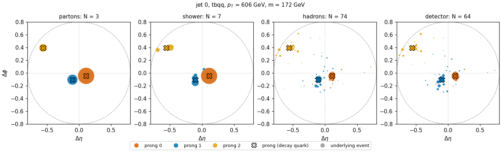

# Physics of the toy jets

**New to jets?** Start with [the primer](primer.md), *Jets from zero*: it explains in words what this page derives.

"A Spray of Hadrons" is a jet generator written from first principles. It makes a jet in stages, each of which the
[primer](primer.md) introduces in words:

- a **hard process** (the energetic collision at the start) makes a quark, a gluon, a W boson or a top quark with a
  large transverse momentum (momentum across the beam). The W boson is a heavy carrier of the weak force, and the top
  quark is the heaviest known particle;
- a **parton shower** turns it into a spray of partons (quarks and gluons) by repeated branching;
- a cartoon of **hadronisation** turns the partons into hadrons (bound states of quarks, mostly pions);
- an **underlying event** adds soft particles from the rest of the proton-proton collision;
- a simple **detector** turns the hadrons into tracks (the paths of charged particles) and calorimeter cells (small
  squares that each record one deposited energy).

The jet is then built as in JetClass, the large public set of simulated jets that the course compares with
([jetclass.md](jetclass.md)). This page defines the model as implemented in `itj.toy` (version 0.2.0, unchanged since
0.1.1) and gives the derivations that the questions use. The defaults are those of the `detector` preset, the last rung
of the ladder below, with every stage on ([Presets](#presets)). The data files are described in
[data_format.md](data_format.md) and the observables in [observables.md](observables.md). The literature values behind
the defaults, with their sources, are in [references.md](references.md).

<p align="center">
  
  <br>
  <em>The same top jet at the four presets (<code>partons</code>, <code>shower</code>, <code>hadrons</code>,
  <code>detector</code>) in the plane (Δη, Δφ) about the jet axis. Marker area: pT; colour: the prong a particle
  comes from (b, and the two quarks of the W), grey for the underlying event; the crosses are the decay quarks.</em>
</p>

## Units and coordinates

| quantity                           | unit |
|------------------------------------|------|
| energies, momenta, masses          | GeV  |
| angles, azimuth                    | rad  |
| impact parameters, flight lengths  | mm   |

Four-vectors (energy and momentum together; see [the primer](primer.md#four-vectors-and-invariant-mass)) are
$(p_x, p_y, p_z, E)$ with $z$ along the beam. A particle has the transverse momentum
$p_T = \sqrt{p_x^2 + p_y^2}$ and the azimuth $\phi$, its angle around the beam. Its direction along the beam is given
by the rapidity $y = \frac{1}{2}\ln\frac{E + p_z}{E - p_z}$ or the pseudorapidity $\eta = -\ln\tan(\theta/2)$
($y = \eta$ for massless particles; see [the primer](primer.md#collider-coordinates)). Distances in the plane of
rapidity and azimuth are

```math
\Delta R_{ij}^2 = (y_i - y_j)^2 + (\phi_i - \phi_j)^2,
```

with $\Delta\phi$ wrapped to $(-\pi, \pi]$. Clustering and the observables use the rapidity $y$. The stored relative
coordinates `part_deta` and `part_dphi` use the pseudorapidity $\eta$, as JetClass does:

```math
\texttt{part\_deta}_i = s\,(\eta_i - \eta_\mathrm{jet}), \qquad s = \begin{cases} +1 & \eta_\mathrm{jet} \ge 0 \\ -1 & \eta_\mathrm{jet} < 0 \end{cases},
\qquad \texttt{part\_dphi}_i = \mathrm{wrap}(\phi_i - \phi_\mathrm{jet}).
```

The sign $s$ mirrors jets in the backward half of the detector onto the forward half. JetClass stores it this way
(checked on every particle of a JetClass file), so the toy does too.

**The generation frame.** Every jet is generated with its seed parton (the parton or heavy particle it starts from; see
[Hard process](#hard-process)) along $+x$ at $y = 0$, $\phi = 0$. In this frame a small opening angle $\theta$ between
two directions close to the seed parton is approximately their $\Delta R$. The error is of order $\theta^3$ (11 % at
$\theta = 0.8$ perpendicular to $\phi$), so the shower can be written in angles. The finished jet is then rotated by
$\phi_\mathrm{jet}$ about $z$ and boosted along $z$ with the rapidity $y_\mathrm{jet}$:

```math
E' = E\cosh y_\mathrm{jet} + p_z \sinh y_\mathrm{jet}, \qquad p_z' = p_z\cosh y_\mathrm{jet} + E \sinh y_\mathrm{jet}.
```

A longitudinal boost (a change to an observer moving along the beam) shifts every rapidity by $y_\mathrm{jet}$ and
leaves $p_T$, $\Delta y$ and $\Delta\phi$ unchanged. All the angles of the shower therefore keep their meaning as
$\Delta R$ in the lab. Containment and jet building always use the exact $\Delta R$.

## Hard process

| parameter                         | symbol             | option                     | default                   | unit |
|-----------------------------------|--------------------|----------------------------|---------------------------|------|
| seed $p_T$ spectrum               | $dN/dp_T \propto p_T^{-n}$ | `pt_spectrum`, `pt_power` | power, 4.5          |      |
| seed $p_T$ range                  |                    | `pt_min`, `pt_max`         | 450, 1100                 | GeV  |
| fixed seed $p_T$                  |                    | `pt_fixed`                 | 600 (with `pt_spectrum` = fixed) | GeV |
| rapidity range                    | $\lvert y\rvert < y_\mathrm{max}$ | `y_max`     | 2.0                       |      |
| QCD quark fraction                | $f_q$              | `qcd_quark_fraction`       | 0.75                      |      |
| QCD quark flavours u, d, s, c, b  |                    | `qcd_flavour_weights`      | 0.50, 0.30, 0.08, 0.08, 0.04 |   |
| W mass, width, window             | $m_W$, $\Gamma_W$  | `w_mass`, `w_width`, `w_window` | 80.4, 2.085, 15      | GeV  |
| top mass, width, window           | $m_t$, $\Gamma_t$  | `top_mass`, `top_width`, `top_window` | 172.5, 1.42, 25 | GeV |
| b mass (decay kinematics)         | $m_b$              | `b_mass`                   | 4.8                       | GeV  |
| W helicity in top decays          | $F_0$              | `w_helicity`               | on ($F_0$ = 0.70, derived) |     |
| containment                       |                    | `containment`              | on                        |      |

The toy has five processes, listed in `itj.toy.PROCESSES`; the code of each jet's process is stored in
`truth_process`. `qcd` makes a QCD jet, which starts from one quark or gluon (QCD, quantum chromodynamics, is the theory
of the strong force). `wqq` makes W → qq̄′ and `tbqq` makes t → bW → bqq̄′. `q` and `g` are QCD jets with a fixed
seed parton. Each jet starts from a **seed parton**: a quark or gluon for QCD, a resonance (a heavy, short-lived
particle) for W and top. The name is kept for the resonances too, although they are not partons.

- **Spectrum and direction.** $p_T$ is drawn from $p_T^{-4.5}$ on [450, 1100] GeV, $y$ uniformly in $[-2, 2]$ and $\phi$
  uniformly. The range is wider than the JetClass window $500 < p_T^\mathrm{jet} < 1000$ GeV, so that the analysis-time
  selection `itj.features.jetclass_selection` is not biased by the edges. The generator itself cuts nothing, which keeps
  the paired samples of [Reproducibility](#reproducibility) paired. A massless seed parton has $E = p_T$ at $y = 0$, a
  resonance $E = \sqrt{p_T^2 + M^2}$.
- **QCD.** The seed parton is a quark with the probability $f_q = 0.75$ (an assumption for Z + jet events at these
  $p_T$), and a gluon otherwise. The quark flavour comes from the weights (u, d, s, c, b) = (0.50, 0.30, 0.08, 0.08,
  0.04). These are roughly what the parton densities of the proton give; equal weights would make 15 % of the QCD jets b
  jets. Half the time the quark is an antiquark. `q` and `g` fix the seed parton.
- **Breit-Wigner masses.** The W and top masses are drawn from the non-relativistic (Cauchy) Breit-Wigner in $m$, the
  peaked mass distribution of an unstable particle ([primer](primer.md#the-particles)):
  $p(m) \propto 1/\bigl((m - M)^2 + \Gamma^2/4\bigr)$, truncated to $|m - M| <$ `w_window` (`top_window`). The masses
  are sampled by inverting the cumulative distribution function (CDF) and stored as `truth_mass`. The relativistic form
  in $m^2$ differs from it by less than 0.003 in the CDF over these windows.
- **Two-body decays.** A particle of mass $M$ decays at rest into masses $m_1$, $m_2$ with the momentum

  ```math
  p^* = \frac{\sqrt{\bigl(M^2 - (m_1 + m_2)^2\bigr)\bigl(M^2 - (m_1 - m_2)^2\bigr)}}{2M},
  ```

  along a direction drawn in the rest frame. The daughters are then boosted with $\boldsymbol\beta = \mathbf{P}/E$.
  The W decays isotropically (in a uniformly random direction) into a massless $q\bar q'$. The top decays isotropically
  into $b W$, with $m_b = 4.8$ GeV in the decay kinematics only; the b is massless in the shower. The W mass is drawn
  from its truncated Breit-Wigner and capped at $m_t - 5$ GeV.
- **W helicity in top decays.** The helicity of the W (its spin along its direction of motion) shapes the angles of its
  decay quarks. Let $c = \cos\theta^*$ be the angle of a W decay quark in the W rest frame, measured from the W
  direction in the top rest frame. With the longitudinal fraction $F_0$ and no distinction between up- and down-type
  quarks,

  ```math
  f(c) = \tfrac{3}{8}(1 + c^2)(1 - F_0) + \tfrac{3}{4}(1 - c^2) F_0, \qquad
  F_0 = \frac{m_t^2}{m_t^2 + 2 m_W^2},
  ```

  evaluated per event and sampled by rejection under the bound 0.75. At the nominal masses $F_0$ = 0.697, close to
  the measured 0.69 ([references.md](references.md#1-hard-process)). `--no-w-helicity` decays the W isotropically. The
  angle is stored as `truth_cos_theta_star`.
- **Containment.** JetClass keeps a W or top jet only if all its decay quarks lie inside the reconstructed jet. The
  toy decides this in the hard stream (the random numbers of the hard process), so that every preset sees the same
  hard processes. An event is kept if two conditions hold. First, every decay quark is within $\Delta R <$ `jet_radius`
  of the resonance axis. **Second**, the anti-kT algorithm (the standard jet-clustering algorithm; see
  [observables.md](observables.md#clustering)) with radius `jet_radius`, run on the decay quarks alone, gives one jet
  that holds all of them. Without the second condition the leading jet misses a whole prong (the particles from one
  decay quark) in about 8 % of the top jets. The hard stream is oversampled until enough events pass. The fraction that
  passes goes to `provenance["containment_efficiency"]`: about 0.93 for W and 0.55 for top with the default spectrum.
  At the same $p_T$ the decay quarks of a top lie further apart than those of a W (`W1.1.3` derives the opening
  angle), so the top loses more.

The smallest and largest pairwise $\Delta R$ of the decay quarks are stored as `truth_dr_min` and `truth_dr_max`. The
partons that start the prongs are stored as `truth_prong_*` (top: 0 = b, 1 and 2 = the W quarks by energy; W: by
energy; QCD: the seed parton).

## Parton shower

The parton shower turns one energetic parton into many by repeated branching
([primer](primer.md#the-parton-shower)). The toy evolves every parton downwards in the opening angle $\theta$ of its
branchings, so each branching is narrower than the one before (angular ordering). A branching $a \to bc$ gives $b$ the
energy fraction $z$ and $c$ the fraction $1 - z$.

| parameter                  | symbol              | option                           | default       | unit |
|----------------------------|---------------------|----------------------------------|---------------|------|
| shower                     |                     | `shower`                         | on            |      |
| coupling: mode, value      | $\alpha_s$          | `alphas_mode`, `alphas_value`    | running, 0.118 ($\alpha_s(M_Z)$) | |
| cutoff                     | $k_{t,\mathrm{cut}}$ | `kt_cut`                        | 1.0           | GeV  |
| QCD start angle            | $\theta_\mathrm{start}$ | `qcd_start_angle`            | 1.0           | rad  |
| colour coherence           |                     | `coherence`                      | on            |      |
| g → qq̄, number of flavours | $T_R n_f$           | `g_to_qq`, `n_flavours`          | on, 5         |      |
| dead cone of the b         | $\theta < m_b/E_b$ vetoed | `dead_cone`                | off           |      |

### Branching probability

In the collinear limit (small opening angles), the probability that a parton of energy $E$ branches at an angle in
$d\theta^2$ with the energy fraction in $dz$ is

```math
dP_{a \to bc} = \frac{\alpha_s(k_t)}{2\pi}\, \frac{d\theta^2}{\theta^2}\, P_{a \to bc}(z)\, dz\;
\Theta(k_t > k_{t,\mathrm{cut}}), \qquad k_t = z(1 - z)\, E\, \theta .
```

The table lists the splitting functions, which give how likely each energy split is. They are at leading order and
without the virtual terms, which the Sudakov factor below supplies. The table also lists the overestimates
$g(z) \ge P(z)$ that the veto algorithm samples from:

| channel                | $P(z)$                                           | overestimate $g(z)$   | $\int g\,dz$ over $[\epsilon, 1 - \epsilon]$ | $z$ drawn as        | accept ratio $P/g$              |
|------------------------|--------------------------------------------------|-----------------------|---------------------------------|---------------------|---------------------------------|
| q → q(z) g(1 - z)      | $C_F \frac{1 + z^2}{1 - z}$                      | $\frac{2C_F}{1 - z}$  | $2C_F \ln\frac{1 - \epsilon}{\epsilon}$ | $1 - z$ log-uniform | $\frac{1 + z^2}{2}$          |
| g → g(z) g(1 - z)      | $C_A\left[\frac{z}{1 - z} + \frac{1 - z}{z} + z(1 - z)\right]$ | $\frac{C_A}{z(1 - z)}$ | $2C_A \ln\frac{1 - \epsilon}{\epsilon}$ | $\mathrm{logit}\,z$ uniform | $1 + \bigl(z(1 - z) - 2\bigr) z(1 - z)$ |
| g → q(z) q̄(1 - z)     | $T_R n_f \left[z^2 + (1 - z)^2\right]$           | $T_R n_f$             | $T_R n_f (1 - 2\epsilon)$       | uniform             | $z^2 + (1 - z)^2$              |

with the colour factors $C_F = 4/3$, $C_A = 3$, $T_R = 1/2$. They are the colour weights of the splittings: the first
for radiation off a quark, the second for radiation off a gluon, the third for a gluon splitting into quarks.
$P_{gg}$ is used over the whole range $0 < z < 1$ with **no** factor 1/2. Its two poles each give
$(\alpha_s C_A/2\pi)(dx/x)(d\theta^2/\theta^2)$. Together they give the soft-gluon density
$(\alpha_s C_A/\pi)(dx/x)(d\theta^2/\theta^2)$ of a gluon, the analogue of $(\alpha_s C_F/\pi)$ for a quark. The
channel is stored as `truth_emis_channel` (0 q → qg, 1 g → gg, 2 g → qq̄).

### Running coupling and cutoff

The strong coupling (the strength of the strong force) runs: it changes with the momentum scale. The toy uses the
one-loop running with $n_f = 5$,

```math
\alpha_s(k_t) = \frac{1}{\beta_0 \ln(k_t^2/\Lambda^2)}, \qquad \beta_0 = \frac{33 - 2n_f}{12\pi},
```

with $\Lambda$ fixed by $\alpha_s(M_Z) = 0.118$: $\Lambda = M_Z\, e^{-1/(2\beta_0\alpha_s(M_Z))}$ = 88 MeV and
$\alpha_s(1\ \mathrm{GeV})$ = 0.34 (derived). `--alphas-mode fixed --alphas-value 0.12` keeps the coupling fixed,
which makes the leading-log formulas below exact targets ([Leading-log results](#leading-log-results)). Since
$z(1 - z) \le 1/4$, a parton of energy $E$ cannot branch below $\theta_\mathrm{min} = 4k_{t,\mathrm{cut}}/E$: there it
is final. In the toy the shower stops at $k_t$ = 1 GeV. PYTHIA, a widely used full event generator, stops at about 0.5
GeV. The split between the shower and hadronisation is not realistic here (only the `detector` level is
calibrated).

### The veto algorithm

**What is sampled.** Write $t = \ln\theta^2$, which decreases during the evolution. Let $f(t)$ be the branching
density per unit $t$ (the integral of $dP$ over $z$). The next branching below the current $t_0$ must have the density

```math
\frac{dP}{dt} = f(t)\, \Delta(t_0, t), \qquad \Delta(t_0, t) = \exp\left(-\int_t^{t_0} f(t')\, dt'\right),
```

where the **Sudakov factor** $\Delta(t_0, t)$ is the probability of no branching between $t_0$ and $t$. If the
primitive of $f$ could be inverted, one would solve $\Delta(t_0, t) = r$ with a uniform random number
$r \sim \mathcal{U}(0, 1)$. With a running coupling, the $z$ limits and the full $P(z)$, the primitive cannot be
inverted. The **veto algorithm** uses an overestimate $g(t) \ge f(t)$ whose primitive can be inverted:

1. draw $t$ from $g\,\Delta_g$: solve $\int_t^{t_0} g = -\ln r$ (for a constant $g = \lambda$:
   $t = t_0 + \ln(r)/\lambda$);
2. accept $t$ with the probability $f(t)/g(t)$;
3. if rejected, set $t_0 \leftarrow t$ and go back to 1.

**Why it works.** The first accepted point at $t$ may follow $n = 0, 1, 2, \ldots$ rejected points at
$t_0 > t_1 > \cdots > t_n > t$. Each rejected point contributes its density $g(t_k)$ times the rejection probability
$1 - f(t_k)/g(t_k)$. The gaps between the points contribute the no-trial probabilities $\Delta_g$, which multiply
to $\Delta_g(t_0, t)$. Summing over $n$ (the ordered integrals of $n$ identical factors give $1/n!$):

```math
\begin{aligned}
P(t) &= \sum_{n=0}^{\infty} \int_{t}^{t_0}\! dt_1 \int_{t}^{t_1}\! dt_2 \cdots \int_{t}^{t_{n-1}}\! dt_n
\prod_{k=1}^{n} \bigl[g(t_k) - f(t_k)\bigr]\; \Delta_g(t_0, t)\, g(t)\, \frac{f(t)}{g(t)} \\
&= f(t)\, \Delta_g(t_0, t) \sum_{n=0}^{\infty} \frac{1}{n!} \left[\int_t^{t_0} (g - f)\, dt'\right]^n
= f(t)\, \Delta_g(t_0, t)\, e^{\int_t^{t_0} (g - f)\, dt'} = f(t)\, \Delta_f(t_0, t).
\end{aligned}
```

The accepted points therefore have exactly the wanted density, whatever the overestimate. Two extensions make it a
shower:

- **Joint sampling of $(t, z)$.** Take $g(t, z) \ge f(t, z)$, draw $t$ from $\int g\,dz$, then $z$ from $g(t, \cdot)$,
  and accept with $f(t, z)/g(t, z)$. Phase-space limits such as $k_t > k_{t,\mathrm{cut}}$ are $\Theta$ functions
  (step functions) in $f$: a point outside is rejected.
- **Several channels.** With $g = \sum_c g_c$, choose the channel with the probability $g_c/g$: the competition of the
  channels is the product of their Sudakov factors.

**In the toy.** Take a parton of energy $E$ that starts at $\theta_\mathrm{start}$. If
$\theta_\mathrm{start} \le \theta_\mathrm{min}$ the parton is final. Otherwise the toy sets
$\epsilon_0 = k_{t,\mathrm{cut}}/(E\,\theta_\mathrm{start})$, the widest $z$ range, valid for every smaller angle
($\epsilon_0 < 1/4$ follows from the guard). It also sets $\alpha_\mathrm{max} = \alpha_s(k_{t,\mathrm{cut}})$, the
largest coupling the shower can reach. The constant trial rate per unit $t$ is then
$\lambda = (\alpha_\mathrm{max}/2\pi)\sum_c I_c$, with the integrals $I_c$ of the table over
$[\epsilon_0, 1 - \epsilon_0]$. Each trial: $\ln\theta^2 \to \ln\theta^2 + \ln(r)/\lambda$; final if
$\theta < \theta_\mathrm{min}$; choose the channel by $I_c$; draw $z$; reject if $k_t < k_{t,\mathrm{cut}}$; accept
with $(P/g)\,(\alpha_s(k_t)/\alpha_\mathrm{max})$. On acceptance the azimuth is $\phi \sim \mathcal{U}(0, 2\pi)$, and
both daughters start their own evolution at the angle of this branching (angular ordering).

The vectorised shower of `itj.toy.shower` runs this loop for all partons of a chunk at once. `shower_one` is the same
algorithm for one parton, written for reading; the tests compare the two. In outline:

```python
import math

C_F, C_A, T_R, M_Z = 4 / 3, 3.0, 0.5, 91.1876


def shower_one(energy, flavour, theta_start, config, rng):
    """Shower one parton (flavour "q" or "g"); return one dict per accepted branching."""
    if config.alphas_mode == "fixed":
        alphas = lambda kt: config.alphas_value  # noqa: E731
    else:
        beta0 = (33 - 2 * 5) / (12 * math.pi)  # the running uses n_f = 5 whatever n_flavours (g -> qqbar) is
        lambda2 = M_Z**2 * math.exp(-1 / (beta0 * config.alphas_value))  # Lambda^2 from alpha_s(M_Z)
        alphas = lambda kt: 1 / (beta0 * math.log(kt**2 / lambda2))  # noqa: E731
    alpha_max = alphas(config.kt_cut)
    emissions = []
    stack = [(energy, flavour, theta_start, 0, True)]  # energy, flavour, start angle, depth, primary
    while stack:
        e, fl, theta, depth, primary = stack.pop()
        theta_min = 4 * config.kt_cut / e  # z (1 - z) <= 1/4
        if theta <= theta_min:
            continue  # final parton
        eps = config.kt_cut / (e * theta)  # the widest z range, valid below theta_start
        log_range = math.log((1 - eps) / eps)
        if fl == "q":
            channels = {"q->qg": 2 * C_F * log_range}
        else:
            channels = {"g->gg": 2 * C_A * log_range}
            if config.g_to_qq:
                channels["g->qq"] = T_R * config.n_flavours * (1 - 2 * eps)
        total = sum(channels.values())
        rate = alpha_max / (2 * math.pi) * total  # trials per unit of ln(theta^2)
        while True:
            theta *= math.exp(math.log(rng.random()) / (2 * rate))  # ln theta^2 += ln(r) / rate
            if theta < theta_min:
                break  # no branching above the cutoff: final parton
            name = "q->qg" if fl == "q" else ("g->gg" if rng.random() * total < channels["g->gg"] else "g->qq")
            u = rng.random()
            if name == "q->qg":  # 1 - z log-uniform
                z = 1 - eps * ((1 - eps) / eps) ** u
                ratio = (1 + z * z) / 2
            elif name == "g->gg":  # logit(z) uniform
                z = 1 / (1 + math.exp(-(math.log(eps / (1 - eps)) + 2 * log_range * u)))
                ratio = 1 + (z * (1 - z) - 2) * z * (1 - z)
            else:  # uniform
                z = eps + (1 - 2 * eps) * u
                ratio = z * z + (1 - z) ** 2
            kt = z * (1 - z) * e * theta
            if kt < config.kt_cut or rng.random() > ratio * alphas(kt) / alpha_max:
                continue  # vetoed: evolve on from this angle
            emissions.append(
                {
                    "theta": theta,
                    "z": z,
                    "kt": kt,
                    "phi": 2 * math.pi * rng.random(),
                    "channel": ("q->qg", "g->gg", "g->qq").index(name),
                    "depth": depth,
                    "primary": primary,
                    "energy": e,
                }
            )
            b, c = {"q->qg": ("q", "g"), "g->gg": ("g", "g"), "g->qq": ("q", "q")}[name]
            stack.append((z * e, b, theta, depth + 1, primary and z >= 0.5))  # angular ordering
            stack.append(((1 - z) * e, c, theta, depth + 1, primary and z < 0.5))
            break
    return emissions
```

The `primary` flag follows the harder daughter. The primary emissions are those of the chain that keeps the
most energy. `depth` counts the branchings above an emission (0 for the first branching of a prong).

### Kinematics

A branching keeps the parent's energy and direction. The daughters are massless, with $|\mathbf{p}_b| = zE$ and
$|\mathbf{p}_c| = (1 - z)E$. Their angles to the parent axis $\mathbf{n}$ satisfy $\theta_b + \theta_c = \theta$ and
$z\sin\theta_b = (1 - z)\sin\theta_c$ (no momentum transverse to $\mathbf{n}$), so

```math
\tan\theta_b = \frac{(1 - z)\sin\theta}{z + (1 - z)\cos\theta}, \qquad \theta_c = \theta - \theta_b, \qquad
\mathbf{n}_{b,c} = \cos\theta_{b,c}\, \mathbf{n} \pm \sin\theta_{b,c}\, \mathbf{u},
```

with $\mathbf{u} = \cos\phi\, \mathbf{e}_1 + \sin\phi\, \mathbf{e}_2$ perpendicular to $\mathbf{n}$. The parent becomes
virtual (it acquires a mass), $m^2 = 2z(1 - z)E^2(1 - \cos\theta) \approx z(1 - z)E^2\theta^2$: this is where the jet
mass comes from. When a daughter branches in turn, its $|\mathbf{p}|$ shrinks a little. So a QCD jet conserves its
energy exactly, but its three-momentum only approximately. This is a standard simplification of toy showers; in a real
shower a recoil partner outside the jet absorbs the difference. The toy then rotates every showered QCD jet as a whole
so that its summed three-momentum points along the seed parton (the jet takes the recoil). The rotation keeps every
energy, mass and opening angle. Without it, $|\sum \mathbf{p}_\perp|/E$ reaches about 0.06 for gluon jets.

### Resonance reshuffle

For W and top jets the four-momentum of the decay must be conserved exactly, so that the parton-level mass peaks sit at
the generated mass. After the shower the toy therefore reshuffles the momenta with the recipe of Herwig (another widely
used event generator). The recipe uses the momenta of the **progenitors**, the decay quarks before the shower:

1. in the resonance rest frame take the decay-quark momenta $\mathbf{q}_i$ ($\sum_i \mathbf{q}_i = 0$; for the top
   the b is massless in the shower, so the $\mathbf{q}_i$ are re-centred, $\mathbf{q}_i \leftarrow \mathbf{q}_i -
   \frac{1}{n}\sum_j \mathbf{q}_j$);
2. $m_i$ = the invariant mass of shower system $i$ (the decay quark and everything it radiated);
3. solve $\sum_i \sqrt{k^2|\mathbf{q}_i|^2 + m_i^2} = M$ for $k$ by Newton iteration from above,
   $k_0 = M / \sum_i |\mathbf{q}_i|$, within $(0, k_\mathrm{max}]$ ($k$ may exceed 1 slightly);
4. move each system to $\bigl(\sqrt{k^2|\mathbf{q}_i|^2 + m_i^2},\; k\mathbf{q}_i\bigr)$: boost it by
   $-\mathbf{P}_i/E_i$ to its rest frame, then by $k\mathbf{q}_i/E_i'$ ($E_i'$ the target energy); a single massless
   parton is set directly to $(k|\mathbf{q}_i|, k\mathbf{q}_i)$;
5. boost back to the lab. If $\sum_i m_i \ge M$, the resonance is showered again (with the next random numbers of the
   shower stream).

Afterwards the final partons of each W and top sum to the resonance four-vector to machine precision (the tests check
$10^{-9}$ internally). Rescaling the post-shower momenta instead, without the progenitor momenta, leaves a net
momentum of a few GeV in the rest frame. The emission record (`truth_emis_*`) keeps the kinematics as generated,
before the reshuffle; `truth_parton_*` holds the final partons after it.

The top is reshuffled in one step with its three systems, so the top four-momentum is exact. The W inside it is not:
the masses of the two W systems take their share of $k$ from the b system as well. At the parton level the W inside a
top has the median mass 82.5 GeV (16-84 %: 79.8-88.8 GeV), against 80.4 GeV (78.8-82.0 GeV) in the hard process. In
48 % of the tops the reshuffle moves it by more than 2 GeV; a W jet keeps its mass exactly. A two-step reshuffle would
fix this: first the two W systems onto the hard W, then the b system and the W system onto the top. It would,
however, change the default output.

### Start angles and colour coherence

Colour is the charge of the strong force ([primer](primer.md#the-particles)). At leading log, soft gluons emitted at
angles larger than the opening of a colour-connected pair see only the total colour charge of the pair. Angular
ordering takes care of this inside a shower. The start angles (the largest angle at which a parton may branch) take
care of it between the decay quarks:

| emitter                    | $\theta_\mathrm{start}$ with coherence | why |
|----------------------------|----------------------------------------|-----|
| QCD seed parton            | `qcd_start_angle` = 1.0                | its colour partner is far away; angles above $R = 0.8$ leave the jet (out-of-cone radiation) |
| W → qq̄′, both quarks       | $\theta_{q\bar q}$                      | a colour singlet: outside the pair's cone the radiation cancels, so W jets have little soft wide-angle radiation |
| top → b                    | $\theta(b, \text{top axis})$            | the b is colour-connected to the top (top radiation before the decay is not simulated) |
| top → W → qq̄′              | $\theta_{q\bar q}$                      | as for the W |

`--no-coherence` starts every decay quark at `qcd_start_angle`: a counterfactual (a deliberately unphysical variant)
of question `W3.2.6`. The optional dead cone, the suppression of radiation from a heavy quark at small angles, vetoes
emissions of the b at $\theta < m_b/E_b$ (about 0.024 at $E_b = 200$ GeV).

### Truth record

The toy stores every accepted branching in `truth_emis_*`. Each entry holds the parent and daughter node ids, the
parent energy, $z$ (of the first daughter, as in $P(z)$), $\theta$, $\phi$, $k_t = z(1 - z)E\theta$, the channel, the
prong it descends from, the primary flag and the depth. The primary emissions are also stored in Lund coordinates, the
axes of the Lund plane (`truth_lund_*`, see [Lund density](#lund-density)):

```math
\ln\frac{1}{\Delta} = \ln\frac{1}{\theta}, \qquad \ln k_t^\mathrm{Lund} = \ln\bigl(\min(z, 1 - z)\, E\, \theta / \mathrm{GeV}\bigr),
\qquad z^\mathrm{Lund} = \min(z, 1 - z).
```

The per-jet summaries are `truth_n_emissions`, `truth_n_primary` (summed over the prongs) and `truth_lnkt_max` (the
hardest primary emission). [data_format.md](data_format.md#truth-branches) lists every column.

## Hadronisation

Hadronisation turns the final partons into hadrons, the particles a detector sees
([primer](primer.md#hadronisation-and-the-underlying-event)). Perturbation theory does not describe it, so the toy
uses a simple model.

| parameter                               | symbol        | option                       | default       | unit |
|-----------------------------------------|---------------|------------------------------|---------------|------|
| hadronisation                           |               | `hadronize`                  | on            |      |
| Field-Feynman parameter                 | $a$           | `ff_a`                       | 0.77          |      |
| $k_T$ width per component               | $\sigma$      | `kt_sigma`                   | 0.24          | GeV  |
| chain stop, smallest hadron energy      | $E_\mathrm{stop}$ | `e_stop`, `e_min_hadron` | 1.5, 0.6      | GeV  |
| $\pi^0$ share, neutral-hadron share     |               | `pi0_fraction`, `neutral_fraction` | 0.34, 0.13 (cal.) |  |
| kaon share of charged, $K_L$ share of neutral |         | `kaon_fraction`, `klong_fraction` | 0.15, 0.60 |      |
| W quarks fragment in the W rest frame   |               | `singlet_frame`              | off           |      |
| hadron-level reshuffle of W and top     |               | `hadron_reshuffle`           | off           |      |
| B hadrons                               |               | `b_hadrons`                  | on            |      |
| B: $c\tau$, $\langle z_B\rangle$, decay multiplicity, charged share | | `b_ctau`, `b_frag_mean`, `b_decay_multiplicity`, `b_charged_share` | 0.46, 0.7, 7, 0.7 | mm, -, -, - |
| semileptonic probability per lepton flavour, cascade | | `semileptonic`, `semileptonic_cascade` | 0.11, 0.10 |   |

(cal.): a starting value that the calibration against JetClass adjusts ([Calibration and
validation](#calibration-and-validation)).

**Independent fragmentation.** Every final parton (gluons like quarks) starts its own chain of hadrons along its
direction (Field and Feynman). At each rank (each step along the chain), with $E_\mathrm{rem}$ the energy left in the
chain:

1. draw the species first (below);
2. draw $z$ from the Field-Feynman function

   ```math
   f(z) = (1 - a) + 3a(1 - z)^2, \qquad \int_0^1 f\,dz = 1, \qquad \langle z \rangle = \frac{1 - a}{2} + \frac{a}{4} = 0.31,
   ```

   a mixture of a uniform density (weight $1 - a$) and $3(1 - z)^2$ (weight $a$), sampled by inverting its CDF (a
   cubic in $z$, solved with Cardano's formula);
3. give the hadron $E_h = \max(zE_\mathrm{rem},\ e_\mathrm{min,hadron},\ m_h + 0.05\ \mathrm{GeV})$;
4. stop when $E_\mathrm{rem} < 2E_\mathrm{stop}$: the remainder becomes the last hadron. Its species is redrawn among
   those with $m_h < E_\mathrm{rem}$ (a photon if none fits, i.e. if the remainder is lighter than a pion).

The energy of every chain is conserved exactly.

**Transverse momentum.** Each break between two ranks gets a transverse kick
$\mathbf{k}_i \sim \mathcal{N}(0, \sigma^2\mathbb{1}_2)$, perpendicular to the parton. Hadron $i$ takes
$\mathbf{k}_i - \mathbf{k}_{i-1}$ and the last one $-\mathbf{k}_\mathrm{last}$, so the kicks of a chain sum to zero, as
in the string model of hadronisation. $\sigma = 0.24$ GeV is PYTHIA's `StringPT:sigma` = 0.335 GeV divided by
$\sqrt{2}$: PYTHIA gives that width to each quark of a break, and a hadron is made of two. If
$|\mathbf{k}| > 0.9|\mathbf{p}_h|$ the transverse part is scaled down to $0.9|\mathbf{p}_h|$. The fraction of capped
hadrons (mostly slow ones at the energy floor) goes to `provenance["hadron_kt_capped"]` (about 5.5 % with the
defaults).

**Species.** A hadron is a $\pi^0$ (a neutral pion) with the probability `pi0_fraction` and a neutral hadron with
`neutral_fraction` ($K_L$, a long-lived neutral kaon, with the share `klong_fraction`, else a neutron). Otherwise it is
a charged hadron ($K^\pm$ with the share `kaon_fraction`, else $\pi^\pm$, charge $\pm 1$ at random). A $\pi^0$ decays
at once into two photons, isotropically in its rest frame, so photons make about twice the $\pi^0$ share by count.
`neutral_fraction` is an effective share. Real jets have about 7-9 % $K_L$ and neutrons, and untracked charged hadrons
also end up in the hadronic calorimeter, the HCAL ([Detector](#detector)).

**B hadrons.** A B hadron contains a b quark and flies a few millimetres before it decays. The b quarks of the hard
process (top decays and b-initiated QCD jets) fragment into a B hadron ($m_B = 5.28$ GeV) at the first rank. Its $z$
is drawn from $f(z) \propto z^\alpha(1 - z)$, whose mean $(\alpha + 1)/(\alpha + 3)$ is `b_frag_mean` = 0.7
($\alpha = 11/3$). b quarks made in the shower by g → bb̄ are treated as light, because massless $n_f = 5$ splittings
down to 1 GeV overproduce them. The B hadron flies the distance $L \sim \mathrm{Exp}(\beta\gamma c\tau)$,
$\beta\gamma = |\mathbf{p}|/m_B$ (a mean of about 9 mm at 100 GeV). It then decays at that vertex into
`b_decay_multiplicity` = 7 daughters, with massless phase space (RAMBO, a standard algorithm for uniform many-body
decays). Each daughter is a charged hadron with the probability `b_charged_share` = 0.7, else a photon (a cartoon: the
daughters are massless in the decay). With the probability `semileptonic` = 0.11 one daughter becomes an electron.
Independently, with the same probability, one becomes a muon. With the probability `semileptonic_cascade` = 0.10 per
flavour one more daughter becomes a lepton (b → c → ℓ). Every semileptonic lepton (a lepton from a weak decay, which
always comes with a neutrino) comes with one daughter turned into an invisible neutrino. The neutrino is dropped: it
lowers the visible top mass as in JetClass. The daughters carry `truth_part_from_b` = 1 and their production vertex,
which the detector turns into impact parameters (the distance by which a track misses the collision point).

### Hadron-level reshuffle

The chains conserve the energy of their partons but not the momentum, so every resonance system gains invariant
mass. In the generation frame the summed hadrons of a W weigh 98 GeV (median, every hadron, before the B decays),
against a parton-level 80.4 GeV. Those of a top weigh 186 GeV against 172.5 GeV. Most of the excess comes from the
transverse kicks of the chains, which open up the soft hadrons. With `kt_sigma` = 0 the W hadrons weigh 86.8 GeV, with
0.12 GeV 90.3 GeV. The hadron masses and the energy floors give the rest. Dropping the hadrons at the floors
($E \le 0.65$ GeV) takes the W from 98.4 to 92.6 GeV, and lowering `e_min_hadron` to 0.2 GeV changes nothing (98.5
GeV). The soft-drop mass (the jet mass after soft, wide-angle particles are removed; see
[observables.md](observables.md#soft-drop)) sees only part of the excess. For the W, $m_\mathrm{SD}$ is 79.8 GeV at
the `shower` level and 83.9 GeV at `hadrons`. Two switches act on W and top jets; both are **off** by default.

**`hadron_reshuffle`** (experimental) restores the four-momentum of every W and top. It applies the recipe of the
[resonance reshuffle](#resonance-reshuffle) to the hadrons before the B and $\pi^0$ decays (their decay products,
neutrinos included, follow the parent). The hadrons of all chains of one prong form a system $i$ of mass $m_i$. In the
rest frame of the parton-level resonance momentum $P$, let $\mathbf{q}_i$ be the parton-level momentum of system $i$.
The toy solves $\sum_i \sqrt{k^2|\mathbf{q}_i|^2 + m_i^2} = M$, boosts each system rigidly to $k\mathbf{q}_i$ and
boosts back. A W takes one step (its two quarks). A top takes two: first the W inside it (its two quarks, with the
parton-level W as target), then the top (the b system and the W system). When both steps succeed, the top and its W
keep their parton-level masses. For the W inside a top, that is the mass after the one-step shower reshuffle, about
2 GeV above the generated W mass (see [Resonance reshuffle](#resonance-reshuffle)). Afterwards the hadrons of every
restored W and top, with all decay products, sum to $P$ to a few $10^{-9}$. The residual is the rounding of the boosted
$\pi^0$ and B decays; the reshuffle itself is exact to $10^{-13}$. This is the identity `hadron_sum` of
[data_format.md](data_format.md#exact-identities). A step whose systems are heavier than the resonance
($\sum_i m_i \ge M$) leaves its hadrons unchanged. It is counted in `provenance["hadron_reshuffle"]` (`failed`, and
`failed_w_in_top` for the first step of a top: such a top is still restored, its W is not). No random number is drawn.
The same particles come out in the same order, only the momenta of W and top jets move, and every pairing of
[Reproducibility](#reproducibility) still holds.

**`singlet_frame`** runs the chains of the two quarks of every W (also inside a top) in the rest frame of the W and
boosts the hadrons back. That frame is the frame of their colour singlet (the colour-neutral quark pair). Independent
fragmentation is not Lorentz invariant: it gives different hadrons in different frames. In the generation frame each
quark of a boosted W fragments as if it had a colour partner of its own energy far away. Its hadrons are those of an
e+e- event (an electron-positron collision) at twice its energy. In the W frame the pair fragments as an e+e- event at
the W mass. QCD jets (whose colour partner is outside the jet) and the b of a top (colour-connected to the outside) keep
the generation frame. The energy is then conserved per chain in the W frame, and the W system almost conserves its
four-momentum by itself (98 GeV becomes 80.3 GeV).

Five seeds of 10 000 jets with `jetclass_selection` (QCD, W, top), with the medians, window fractions and
multiplicities of the validation table ([Calibration and validation](#calibration-and-validation)):

| level, switches | m_SD W / top [GeV] | window W / top | $\tau_{21}$ W | $\tau_{32}$ top | N W / top |
|---|---|---|---|---|---|
| `shower` | 79.8 / 172.0 | 0.81 / 0.84 | 0.171 | 0.251 | 4.8 / 6.8 |
| `hadrons` | 83.9 / 174.8 | 0.79 / 0.84 | 0.335 | 0.454 | 51.6 / 69.9 |
| `hadrons`, `hadron_reshuffle` | 67.8 / 162.3 | 0.57 / 0.81 | 0.410 | 0.502 | 53.2 / 72.3 |
| `hadrons`, `singlet_frame` | 79.6 / 172.0 | 0.81 / 0.84 | 0.288 | 0.434 | 31.4 / 55.4 |
| `hadrons`, both | 79.6 / 167.6 | 0.81 / 0.83 | 0.288 | 0.441 | 31.4 / 56.1 |
| `detector` (default) | 81.6 / 169.8 | 0.78 / 0.82 | 0.364 | 0.471 | 38.0 / 53.2 |
| `detector`, `hadron_reshuffle` | 66.2 / 157.0 | 0.53 / 0.77 | 0.438 | 0.516 | 39.8 / 55.2 |
| `detector`, `singlet_frame` | 78.8 / 168.7 | 0.80 / 0.82 | 0.330 | 0.455 | 25.3 / 44.9 |
| `detector`, both | 78.9 / 164.3 | 0.80 / 0.81 | 0.330 | 0.463 | 25.3 / 45.5 |
| JetClass | 77.3 / 164.9 | 0.68 / 0.69 | 0.366 | 0.501 | 32.2 / 50.9 |

The toy $\tau_N$ (N-subjettiness; see [observables.md](observables.md#n-subjettiness)) use WTA-kT axes; the JetClass
ones are the stored branches (one-pass kT axes). With one-pass kT axes for the toy as well, the conclusions hold. Only
$\tau_{21}$ of the W with `hadron_reshuffle` moves, from 0.438 to 0.445, just outside the accepted range of `tau21_w`
(at most 0.44). In the validation table, `hadron_reshuffle` fails `msd_median_w` and `msd_window_w`. It sits at the
edge of `msd_median_top` (157.0 GeV, at least 156) and of `tau21_w`. `singlet_frame` fails `n_w`.

In the generation frame the reshuffle overcorrects. It takes the 18 GeV of excess mass out of the relative motion of
the hard cores of the prongs. The prong systems keep their inflated masses: medians 40 and 17 GeV for the two prongs of
a W, against 16 and 10 GeV with `singlet_frame`. The soft-drop mass of the W falls 12 GeV below the `shower`
level, and 18-19 % of the W systems are too heavy to be reshuffled at all. The restored W are often distorted far
beyond a small correction (3000 W jets). The scale factor $k$ has the median 0.715, 20 % of the W have $k < 0.5$ and
the smallest is 0.019. The two prongs are thus pushed onto each other: their opening angle shrinks by a median factor
0.74, and by 0.13 for 1 % of the W. Single hadrons change their energy by factors from 0.04 to 56, 18 % of them by more
than 50 %. Of the hadrons, 5 % move from more than 0.8 rad of the W axis to within it. With `singlet_frame`, $k$ lies
between 0.81 and 1.006 and the hadron energies change by factors 0.80-1.23. The W peak then returns to the `shower`
level, and the reshuffle almost never fails (1 system in 10 000). The cost is that the W quarks make a third fewer
particles (the fragmentation was never tuned to e+e- multiplicities), and $\tau_{21}$ of the W falls by 0.03. QCD jets
are never reshuffled, for three reasons. The target would be the showered jet, which has no physical mass to restore
(hadronisation does raise jet masses). The chains of 40 % of the QCD jets are already heavier together than the
parton-level jet. Finally, the toy QCD masses lie below JetClass (m_SD 19.4 against 23.0 GeV), so a reshuffle would move
them further away.

Neither switch can be calibrated with the knobs of the calibration (45 000 jets per point, `detector`,
`jetclass_selection`). With `hadron_reshuffle` the W $m_\mathrm{SD}$ median stays between 66.1 and 66.8 GeV for
`ue_density` 0.7-4, `pi0_fraction` 0.20-0.50, `neutral_fraction` 0.13-0.20 and `b_decay_multiplicity` 5-7. The W
window fraction stays between 0.52 and 0.54. The parameter that matters is `kt_sigma`, not one of these knobs (6000 W
jets). With the reshuffle the W $m_\mathrm{SD}$ median is 66.3 GeV at 0.24 GeV (1049 failed steps), 70.4 GeV at 0.12
GeV (295) and 73.2 GeV at 0 (135). That is still below the 75 GeV of the original accepted range. Without the
reshuffle, `kt_sigma` moves it by less than 1 GeV (81.5, 81.0, 80.7 GeV). With both switches the W multiplicity reaches
27 only at `ue_density` 2.5 (27.4 particles; QCD jets 37.9, top window 0.82). `pi0_fraction` 0.45 adds 0.7 particles
and raises the photon share of QCD jets from 0.40 to 0.52. Turning either switch on would need a retune of
the fragmentation parameters themselves, not only of the calibration knobs.

## Underlying event

| parameter                       | option                       | default         | unit |
|---------------------------------|------------------------------|-----------------|------|
| underlying event                | `ue`                         | on              |      |
| density                         | `ue_density`                 | 0.7 (cal.)      | particles per unit area in $(y, \phi)$ |
| disc radius                     | `ue_radius`                  | 1.0 ($R$ + 0.2) |      |
| $p_T$: minimum + exponential mean | `ue_pt_min`, `ue_pt_mean`  | 0.3, 0.7        | GeV  |

The underlying event (UE) is the soft spray from the rest of the proton-proton collision
([primer](primer.md#hadronisation-and-the-underlying-event)). Besides the hard process, other partons of the same two
protons interact (multiple parton interactions) and add soft particles everywhere in the event. The toy adds
$N \sim \mathrm{Poisson}(\rho_N\, \pi R_\mathrm{UE}^2)$ hadrons (2.2 on average with the defaults). They are uniform in
$(y, \phi)$ inside a disc of radius `ue_radius` around the seed-parton axis, with $p_T = p_{T,\mathrm{min}} +
\mathrm{Exp}(\langle p_T \rangle)$ (mean 1 GeV) and the species of [Hadronisation](#hadronisation). About 1.4 of them
and 1.4 GeV of $p_T$ fall inside a jet of radius 0.8. `ue_density` is a calibration knob. The ATLAS experiment at the
Large Hadron Collider (LHC) measured about one charged particle with $p_T > 0.5$ GeV per unit $\eta\phi$ at 13 TeV.
This gives its order of magnitude only. Its value 0.7 matches the number of particles per unit area in the
outer ring $0.65 < \Delta R < 0.8$ of the JetClass W and QCD jets. W jets radiate little at large angles, so the ring
sees mostly the underlying event. The toy UE particles are softer than those of JetClass, which also has initial-state
radiation (gluons radiated by the incoming partons) there. UE particles carry `truth_part_is_ue` = 1 and
`truth_part_prong` = -1. JetClass has multiple parton interactions and no pileup (extra collisions in the same bunch
crossing); the toy has no pileup either.

## Detector

The detector is a cartoon of the Delphes CMS card behind JetClass. Delphes is a fast detector simulation, and its CMS
card describes the CMS experiment at the LHC. The toy has tracks for charged particles and two calorimeters for
everything else: the electromagnetic calorimeter (ECAL) and the HCAL. It also has a perfect particle flow, the
combination of tracks and calorimeter cells into one list of particles ([primer](primer.md#what-a-detector-sees)).

| parameter                                   | option                              | default        | unit |
|---------------------------------------------|-------------------------------------|----------------|------|
| detector                                    | `detector`                          | on             |      |
| track $p_T$ threshold                       | `track_pt_min`                      | 0.1            | GeV  |
| track efficiency, $\lvert\eta\rvert \le 1.5$, $p_T \le 1$ / $> 1$ GeV | `track_eff_low`, `track_eff_high` | 0.70, 0.95 |   |
| track efficiency, $1.5 < \lvert\eta\rvert \le 2.5$ | `track_eff_fwd_low`, `track_eff_fwd_high` | 0.60, 0.85 | |
| lepton efficiency (e, μ)                    | `lepton_eff`                        | 0.95           |      |
| track resolution $\sigma/p_T = a \oplus b\,p_T$ | `track_res_const`, `track_res_slope` | 0.01, $2 \times 10^{-4}$ | -, 1/GeV |
| impact-parameter resolution $\sqrt{a^2 + (b/p_T)^2}$ | `ip_res_const`, `ip_res_pt` | 0.015, 0.1   | mm, mm GeV |
| ECAL cell, threshold, significance          | `ecal_cell`, `ecal_threshold`, `ecal_signif` | 0.0174, 0.5, 2 | -, GeV, - |
| ECAL resolution $f(\eta)\sqrt{(aE)^2 + b^2E + c^2}$ | `ecal_res_const`, `ecal_res_stoch`, `ecal_res_noise` | 0.008, 0.11, 0.40 | -, $\sqrt{\mathrm{GeV}}$, GeV |
| HCAL cell, threshold, significance          | `hcal_cell`, `hcal_threshold`, `hcal_signif` | 0.087, 1.0, 1 | -, GeV, - |
| HCAL resolution $\sqrt{(aE)^2 + b^2E}$      | `hcal_res_const`, `hcal_res_stoch`  | 0.05, 1.5      | -, $\sqrt{\mathrm{GeV}}$ |
| forward calorimeter ($\lvert\eta\rvert > 2.5$, one resolution for its electromagnetic and hadronic cells; Delphes keeps the HCAL resolution up to $\lvert\eta\rvert = 3$) $\sqrt{(aE)^2 + b^2E}$ | `fwd_res_const`, `fwd_res_stoch` | 0.107, 2.08 | -, $\sqrt{\mathrm{GeV}}$ |
| cell position                               | `cell_position`                     | random (or centre) |  |

**Tracks** (charged hadrons, electrons, muons). The efficiency is 0 for $p_T \le$ `track_pt_min` and for
$|\eta| > 2.5$, and the values of the table otherwise. Electrons and muons use `lepton_eff` and get their
particle-identification (PID) flag. The $p_T$ is smeared (given a random error that models the resolution) with
$\sigma/p_T = \sqrt{0.01^2 + (2 \times 10^{-4}\,p_T)^2}$ at a fixed direction; the charge is kept. The impact
parameters are the signed projections of the production vertex $(x, y, z)$, which is non-zero only for B decay
products. They get Gaussian noise of the width $\sigma = \sqrt{0.015^2 + (0.1/p_T)^2}$ mm, stored as
`part_d0err` = `part_dzerr` = $\sigma$:

```math
d_0 = \frac{x\,p_y - y\,p_x}{p_T}, \qquad d_z = z - \frac{(x\,p_x + y\,p_y)\,p_z}{p_T^2}.
```

**Calorimeters.** Photons (including those from $\pi^0$) and untracked electrons go to the ECAL. Neutral hadrons and
**untracked charged hadrons** (efficiency failure, below `track_pt_min` or beyond $|\eta| = 2.5$) go to the HCAL, as in
Delphes. Untracked muons are lost. The cells are squares in $(\eta, \phi)$: ECAL 0.0174 (360 bins in $\phi$), HCAL
0.087 (72 bins), keyed by $(\lfloor \eta/\Delta \rfloor, \lfloor (\phi + \pi)/(2\pi/n_\phi) \rfloor)$. Beyond
$|\eta| = 2.5$ a forward calorimeter with the HCAL cell size and the forward resolution takes everything. It has
separate electromagnetic and hadronic cells (forward photons keep the photon flag, forward hadrons the neutral-hadron
flag). The energy in a cell is smeared **log-normally** with the mean $E$ and the width $\sigma(E)$ (as Delphes; no
negative energies), with

```math
\sigma_\mathrm{ECAL}(E) = f(\eta)\sqrt{(0.008E)^2 + 0.11^2 E + 0.40^2}, \qquad
f(\eta) = \begin{cases} 1 + 0.64\,\eta^2 & |\eta| \le 1.5 \\ 2.16 + 5.6\,(|\eta| - 2)^2 & 1.5 < |\eta| \le 2.5 \end{cases},
\qquad \sigma_\mathrm{HCAL}(E) = \sqrt{(0.05E)^2 + 1.5^2 E}.
```

A cell is kept if $E_\mathrm{meas} >$ threshold and $E_\mathrm{meas}/\sigma(E_\mathrm{meas}) >$ significance. At
$\eta = 0$ the ECAL significance cut makes the effective photon threshold about 0.83 GeV (JetClass has photons down
to $p_T$ = 0.45 GeV). Each kept cell becomes one massless photon (ECAL) or neutral hadron (HCAL, forward). The particle
sits at a uniform random point inside the cell, or at its centre with `--cell-position centre` (a grid that a network
can learn: a counterfactual of `W3.2.6`). A cell inherits the prong, the parton and the UE flag of its largest
contributor and stores that contributor's energy share as `truth_part_purity`.

**Particle flow** is perfect for **tracked** charged particles: they leave no calorimeter energy. Neutral particles
have $d_0 = d_z = 0$ and zero errors, as in JetClass. Below the `detector` preset every hadron (or parton) is a
particle with its true momentum and true impact parameters (errors 0).

## Building the jet

1. **Particles.** All particles of the event (jet hadrons, UE, or partons at the lower presets) in the lab frame.
2. **Clustering.** Anti-kT with $R$ = `jet_radius` = 0.8 (`itj.cluster.leading_jet`); the leading jet (the one with the
   largest transverse momentum) is kept. `--jet-def cone` takes all particles with $\Delta R < R$ of the seed-parton
   axis instead (faster; the two differ in a small fraction of jets).
3. **Constituents** are sorted by $p_T$, descending, and stored with the relative coordinates of
   [Units and coordinates](#units-and-coordinates).
4. **Jet branches.** `itj.observables.jet_branches` ([observables.md](observables.md#jetclass-conventions)) computes
   them all: `jet_pt`, `jet_eta`, `jet_phi`, `jet_energy` of the four-vector sum of the constituents;
   `jet_nparticles`; the soft-drop mass `jet_sdmass` (C/A, $\beta = 0$, $z_\mathrm{cut} = 0.1$, $R_0 = 0.8$); and
   N-subjettiness `jet_tau1..4` ($\beta = 1$, $R_0 = 0.8$, WTA-kT axes for speed). JetClass was made with one-pass
   minimised axes (see [observables.md](observables.md#jetclass-conventions)).
5. **Labels and auxiliary branches** as JetClass ([data_format.md](data_format.md#jetclass-branches)), then the
   truth.

There is no cut on the reconstructed jet. `jet_pt_min` and `jet_pt_max` exist but are off in every task file,
because a cut would break the pairing between presets. When you compare with JetClass, apply the JetClass window
$500 < p_T^\mathrm{jet} < 1000$ GeV at analysis time with `itj.features.jetclass_selection`. It removes about 36 % of
the toy jets.

| parameter           | option                         | default            | unit |
|---------------------|--------------------------------|--------------------|------|
| jet definition, radius | `jet_def`, `jet_radius`     | antikt, 0.8        |      |
| reco jet $p_T$ cut  | `jet_pt_min`, `jet_pt_max`     | none, none         | GeV  |
| soft drop           | `sd_zcut`, `sd_beta`           | 0.1, 0             |      |
| N-subjettiness      | `tau_beta`, `tau_r0`, `tau_axes` | 1, 0.8, wta_kt   |      |

## Presets

The presets switch the stages on one after the other (a cumulative ladder). Every option can be changed on top of a
preset: `preset("detector", coherence=False)` in Python, `--preset detector --no-coherence` on the command line.

| preset               | shower | hadronize | b_hadrons | ue  | detector | `part_*` holds |
|----------------------|--------|-----------|-----------|-----|----------|----------------|
| `partons`            | off    | off       | off       | off | off      | 1 (QCD), 2 (W) or 3 (top) partons; PID flags 0, charge 0, $d_0$ = 0 |
| `shower`             | on     | off       | off       | off | off      | massless showered partons; PID flags 0 |
| `hadrons`            | on     | on        | on        | on  | off      | hadrons, photons from $\pi^0$, e and μ from B decays (neutrinos dropped); true $d_0$, $d_z$, errors 0 |
| `detector` (default) | on     | on        | on        | on  | on       | tracks and ECAL, HCAL and forward cells, impact parameters with errors |

Only the `detector` level is calibrated to JetClass. The change from `shower` to `hadrons` mixes perturbative physics
(computable as a series in the strong coupling) and non-perturbative physics. How it splits between the two is a
property of this toy, because its shower stops at 1 GeV. This is why the tasks say "in this toy" when they ask about
it.

## Leading-log results

The shower is built so that its soft and collinear limit is leading-log QCD. Leading log is the approximation that
keeps only the largest logarithms of the soft and collinear limits. The results below are what the questions of tasks
`W1.2` to `W1.4` check; most of them are stretch questions. Each result ends with the number for the defaults of the
corresponding data set (fixed $\alpha_s = 0.12$, $E = 600$ GeV, $R = 0.8$, $k_{t,\mathrm{cut}}$ = 1 GeV).

### Lund density

In the soft ($x = 1 - z \ll 1$) and collinear ($\theta \ll 1$) limit a parton of colour charge $C_R$ emits a gluon
with

```math
dP = \frac{\alpha_s}{2\pi}\, \frac{d\theta^2}{\theta^2}\, P(z)\, dz \;\to\;
\frac{\alpha_s}{2\pi}\, \frac{2\, d\theta}{\theta}\, \frac{2C_R\, dx}{x} = \frac{2\alpha_s C_R}{\pi}\,
d\ln\frac{1}{\theta}\; d\ln\frac{1}{x}.
```

The primary Lund plane is a map of the emissions of a jet ([observables.md](observables.md#the-lund-plane)). It
records the declusterings of the harder branch with $\Delta \approx \theta$ and $k_t = x\,p_T\,\Delta$. At fixed
$\Delta$, $d\ln k_t = d\ln x$, so the density of primary emissions per jet is flat:

```math
\rho(\Delta, k_t) \equiv \frac{1}{N_\mathrm{jet}}\, \frac{dn}{d\ln(1/\Delta)\, d\ln k_t} \simeq \frac{2\alpha_s C_R}{\pi}.
```

The emissions fill the triangle $k_t < p_T\Delta/2$ (the softer branch has $z \le 1/2$),
$\Delta < \theta_\mathrm{start}$ and above the cutoff. The toy cuts on $z(1 - z)E\theta > k_{t,\mathrm{cut}}$, while
the Lund $k_t$ is $\min(z, 1 - z)E\theta$. The cutoff line on the Lund plane is therefore

```math
k_t^\mathrm{min}(\Delta) = \frac{E\Delta}{2}\left(1 - \sqrt{1 - \frac{4k_{t,\mathrm{cut}}}{E\Delta}}\right),
```

which runs from $\ln(k_t/\mathrm{GeV}) = 0$ for soft emissions to $\ln 2$ where it meets the edge $z = 1/2$. Finite
$z$ (the full $P(z)$), g → qq̄ and the running coupling (which makes the density rise towards low $k_t$) correct the
flat value. For the defaults: $2\alpha_s C_F/\pi$ = **0.102** for quarks and $2\alpha_s C_A/\pi$ = **0.229** for gluons
at $\alpha_s = 0.12$ (ratio $C_A/C_F$ = 2.25).

**On reconstructed jets** (`W1.2.7`) the plane moves away from this value. For $k_t$ a few times $k_{t,\mathrm{cut}}$
(about 1.6-7 GeV), hadronisation about doubles the primary density of QCD jets against the shower truth. The random
positions of the calorimeter cells add a ridge just inside the HCAL cell size ($\ln 1/\Delta$ about 2.4-3.0).

**Number of primary emissions.** Integrating the full $P_{qq}$ over $z$ up to $1 - z > k_{t,\mathrm{cut}}/(E\theta)$
gives $\int_0^{1-\epsilon} \frac{1 + z^2}{1 - z}dz = 2\ln\frac{1}{\epsilon} - \frac{3}{2} + O(\epsilon)$. Write
$\ell = \ln(E\theta/k_{t,\mathrm{cut}})$, so that $d\theta^2/\theta^2 = 2\,d\ell$, and integrate from
$\theta_\mathrm{min}$ ($\ell = \ln 4$) to $\theta_\mathrm{start}$ ($\ell = L$):

```math
\langle n_\mathrm{primary} \rangle = \frac{\alpha_s C_F}{\pi}\int_{\ln 4}^{L} \left(2\ell - \frac{3}{2}\right) d\ell
= \frac{\alpha_s C_F}{\pi}\left[\left(L - \frac{3}{4}\right)^2 - \left(\ln 4 - \frac{3}{4}\right)^2\right],
\qquad L = \ln\frac{E\,\theta_\mathrm{start}}{k_{t,\mathrm{cut}}}.
```

For a 600 GeV quark with $\theta_\mathrm{start}$ = 1: $L = \ln 600$ = 6.40 and $\langle n_\mathrm{primary}\rangle$ =
**1.60** (`truth_n_primary`).

### Sudakov factor

The probability that a quark emits nothing between its start angle $\theta_0$ and $\theta$ is the Sudakov factor of
[the veto algorithm](#the-veto-algorithm). In the soft limit, $P \to 2C_F/x$ with $k_t \approx xE\theta' >
k_{t,\mathrm{cut}}$:

```math
-\ln\Delta(\theta_0, \theta) = \int_{\theta^2}^{\theta_0^2} \frac{d\theta'^2}{\theta'^2}\, \frac{\alpha_s}{2\pi}
\int_{k_{t,\mathrm{cut}}/(E\theta')}^{1} \frac{2C_F\, dx}{x}
= \frac{\alpha_s C_F}{\pi}\left[\ln^2\frac{E\theta_0}{k_{t,\mathrm{cut}}} - \ln^2\frac{E\theta}{k_{t,\mathrm{cut}}}\right].
```

$\Delta(\theta_0, \theta)$ is the cumulative distribution of the angle of the first emission (jets without any
emission above the cutoff sit at $\theta = 0$). The double-log formula keeps only the soft pole of $P_{qq}$. The
hard-collinear part ($-3/2$ in the integral above) reduces the emission probability, so with it

```math
-\ln\Delta(\theta_0, \theta) = \frac{\alpha_s C_F}{\pi}\left[\left(\ln\frac{E\theta_0}{k_{t,\mathrm{cut}}} - \frac{3}{4}\right)^2
- \left(\ln\frac{E\theta}{k_{t,\mathrm{cut}}} - \frac{3}{4}\right)^2\right].
```

For a 600 GeV quark from $\theta_0$ = 1 the probability of no emission above $\theta$ = 0.1 is 0.29 at double log and
0.35 with the hard-collinear term. `itj.toy.sudakov_cdf` integrates the exact $P_{qq}$ with the exact $z$ limits
numerically; the tests use it as the reference.

### Jet mass

A soft emission $x$ at the angle $\theta$ gives the jet the mass $m^2 \approx x\,p_T^2\theta^2$, that is the normalised
mass $\rho = m^2/(p_T^2R^2) = x\theta^2/R^2$. The jet has a mass below $\rho$ if no emission has
$x\theta^2/R^2 > \rho$. In the plane $(\ln 1/x, \ln R^2/\theta^2)$ the density is $\alpha_s C_R/\pi$ per unit area,
and this region is a triangle of area $\frac{1}{2}\ln^2(1/\rho)$. Adding the hard-collinear term $B_i$:

```math
\Sigma(\rho) = e^{-\mathcal{R}(\rho)}, \qquad
\mathcal{R}(\rho) = \frac{\alpha_s C_R}{\pi}\left[\frac{1}{2}\ln^2\frac{1}{\rho} + B_i \ln\frac{1}{\rho}\right],
\qquad B_q = -\frac{3}{4}, \quad B_g = -\frac{11C_A - 4T_R n_f}{12C_A} = -0.64 .
```

The distribution of $L = \ln(1/\rho)$ is $\rho\,d\sigma/d\rho = d\sigma/dL = \mathcal{R}'\,e^{-\mathcal{R}}$ with
$\mathcal{R}' = (\alpha_s C_R/\pi)(L + B_i)$. It peaks where $\mathcal{R}'' = \mathcal{R}'^2$:

```math
\ln\frac{1}{\rho_\mathrm{peak}} = \sqrt{\frac{\pi}{\alpha_s C_R}} - B_i, \qquad
m_\mathrm{peak} = p_T R\, e^{-\frac{1}{2}\ln(1/\rho_\mathrm{peak})}.
```

At double log ($B_i = 0$) the peak sits at **52 GeV** for quarks and **110 GeV** for gluons ($p_T$ = 600 GeV). With
the hard-collinear term it sits at **36 GeV** and **80 GeV** (`from itj.toy.validate import mass_peak_ll`). A toy
shower with the partons inside $R$ lies in between: 44 and 85 GeV, the means of five seeds. The peak is broad, and the
estimate moves by about 5 GeV with the bin width and the fit window. About 12 % of fixed-coupling quark jets have no
emission inside $R$ and $m = 0$: leave them out of the logarithmic histogram.

**Soft drop at single log.** Soft drop with $\beta = 0$ removes the emissions with $x < z_\mathrm{cut}$. For
$\rho \ll z_\mathrm{cut}$ the soft logarithm is therefore cut off, and the double log becomes a single log:

```math
\rho\,\frac{d\sigma}{d\rho} \approx \frac{\alpha_s C_R}{\pi}\left(\ln\frac{1}{z_\mathrm{cut}} + B_i\right)
\quad (\text{before the Sudakov factor}).
```

The QCD soft-drop mass distribution is flatter, smaller at large mass and less sensitive to non-perturbative effects.
This is why $m_\mathrm{SD}$ is the standard mass for tagging (telling W and top jets from QCD jets).

### Power counting

Power counting estimates how the observables of [observables.md](observables.md) scale with the radiation. Take a jet
of normalised mass $e_2 \sim m^2/p_T^2$ (with $\beta = 2$):

- **One-prong QCD jets.** The mass comes from one soft-collinear emission. A second emission that contributes to
  $e_3$ costs another power of the same small quantity: $e_3 \sim e_2^2$. Hence $D_2 = e_3/e_2^3 \sim 1/e_2 \gg 1$, and
  $\tau_{21}$ is of order one.
- **Two-prong jets (W).** The mass is fixed by the hard splitting, $e_2 \sim z(1 - z)\Delta R_{q\bar q}^2$. The
  three-particle function $e_3$ needs one soft emission around either prong: $e_3 \sim e_2 \times$ (the energy fraction
  of that emission times its angle$^\beta$). So $e_3 \lesssim e_2^3$, and $D_2 = e_3/e_2^3$ is at most of order one
  (parametrically small for a clean two-prong jet), against $D_2 \sim 1/e_2 \gg 1$ for one prong; $\tau_{21} \ll 1$.
  The measured $D_2$ of W jets is of order one because hadronisation, the underlying event and the detector add soft
  radiation around the prongs.
- **Coherence.** The colour-singlet start angle $\theta_{q\bar q}$ keeps the wide-angle radiation of W jets small; the
  `--no-coherence` file of `W3.2.6` switches this off.

## Multiplicity

The number of particles is IRC unsafe: it changes when a very soft particle is added or a particle splits in two
([observables.md](observables.md#irc-safety)). It also depends on the cutoff. Its ratio between gluon and quark jets
still measures the colour charges. At double-log accuracy every emission radiates further. The mean multiplicity of
both then grows as $\exp\sqrt{(16C_A/\beta_0)\ln(E/\Lambda)}$ with $\beta_0 = 11C_A/3 - 2n_f/3$, where
$\alpha_s = 4\pi/(\beta_0 \ln(Q^2/\Lambda^2))$. Ellis, Stirling and Webber write the same growth as
$\exp\sqrt{(2C_A/\pi b)\ln(Q^2/\Lambda^2)}$ with $b = \beta_0/(4\pi)$. The ratio tends to

```math
\frac{\langle N_g \rangle}{\langle N_q \rangle} \to \frac{C_A}{C_F} = \frac{9}{4} = 2.25 .
```

Energy conservation, the hard-collinear terms and hadronisation lower it to about 1.5-1.8 at the jet energies of LEP
(the former electron-positron collider at CERN) and the LHC. Energy conservation matters because a gluon cannot
radiate more energy than it has. In the toy
at 600 GeV the ratio is about 1.68 for showered partons, 1.46 for hadrons and 1.46 at the detector. Hadronisation adds
particles to quark and gluon jets alike, and the detector merges neutral particles into cells.

## Calibration and validation

The toy is calibrated at the `detector` level against the JetClass validation files: the first 100 000 jets of
`ZJetsToNuNu_120`, `WToQQ_120` and `TTBar_120`, with `jetclass_selection` applied to the toy. Only three knobs are
tuned. `pi0_fraction` (0.31 before the calibration, now 0.34) and `neutral_fraction` (0.10, now 0.13) set the
composition by particle type. `ue_density` (1.0, now 0.7) sets the particles at large angles
([Underlying event](#underlying-event)). `b_decay_multiplicity` stays at 7 because the top multiplicity is not too low.
The shower is checked against the leading-log results above. `jetgen validate` (and `itj.toy.validate()`) recomputes
this table; (sel.) marks rows that apply `jetclass_selection` first.

| check | sample | toy | JetClass or leading log | accepted range |
|---|---|---|---|---|
| `lund_q`: primary Lund density in the box $\ln(1/\Delta) \in [0.5, 2.5]$, $\ln k_t \in [0.5, 2.0]$ | q, $E$ = 600 GeV, fixed $\alpha_s$ 0.12, `shower` | 0.107 | LL 0.102 | 0.095-0.125 |
| `lund_g` | g, as above | 0.218 | LL 0.229 | 0.195-0.245 |
| `lund_ratio` | g / q | 2.05 | LL 2.25 | 1.70-2.40 |
| `n_primary_q` | primary emissions per q jet | 1.58 | formula 1.60 | 1.45-1.75 |
| `mass_peak_q` / `_g` [GeV] | peak of $d\sigma/d\ln\rho$, partons in $R$ | 44 / 85 | LL 52 / 110, with $B_i$ 36 / 80 | 36-52 / 80-110 |
| `ng_nq_shower` / `_hadrons` / `_detector` | q, g, running coupling | 1.68 / 1.46 / 1.46 | DLA 2.25 | 1.55-1.90 / 1.35-1.65 / 1.30-1.65 |
| `containment_w` / `_top` | hard process | 0.93 / 0.55 | | 0.90-0.97 / 0.50-0.72 |
| `msd_median_w` / `_top` [GeV] | `detector` (sel.) | 81.6 / 169.8 | JetClass 77.3 / 164.9 | 75-85 / 156-176 |
| `msd_window_w` [65, 95] / `_top` [140, 200] | `detector` (sel.) | 0.78 / 0.82 | JetClass 0.68 / 0.69 | 0.62-0.84 / 0.62-0.88 |
| `tau21_qcd` / `_w` | `detector` (sel.) | 0.610 / 0.364 | JetClass 0.608 / 0.366 | 0.56-0.68 / 0.33-0.44 |
| `tau32_qcd` / `_top` | `detector` (sel.) | 0.765 / 0.471 | JetClass 0.763 / 0.501 | 0.72-0.84 / 0.43-0.53 |
| `d2_ratio`: median $D_2$ ($\beta = 2$) QCD / W | `detector` (sel.) | 4.7 (12.3 / 2.7) | JetClass 4.0 (9.1 / 2.2) | > 3 |
| `n_qcd` / `n_w` / `n_top` | multiplicity, `detector` (sel.) | 35.8 / 38.0 / 53.2 | JetClass 35.3 / 32.2 / 50.9 | 31-40 / 27-40 / 44-57 |
| `frac_charged` / `_neutral` / `_photon` | QCD, by count (sel.) | 0.487 / 0.107 / 0.406 | JetClass 0.485 / 0.107 / 0.402 | 0.44-0.52 / 0.07-0.15 / 0.36-0.44 |
| `lepton_top` | (e + μ) share of top-jet particles (sel.) | 0.67 % (QCD 0.03 %) | JetClass 1.24 % (QCD 0.53 %) | 0.3-1.2 % and > 3 × the QCD share |
| `hadron_cap_fraction` | hadrons with a capped $k_T$, `hadrons` | 5.5 % | | < 20 % |
| `speed_detector` | jets per second and core | about 850 | target 500 | > 100 |

The toy numbers are the means of five random seeds with `-n 10000`. The two Lund samples (the first five rows) have at least
10 000 jets whatever `-n` says. They take about a second each, and on fewer jets the parabola fit of the broad mass peaks
is unstable. Even at 10 000 jets `mass_peak_q` moves by about 4 GeV from random seed to random seed, and its fit is
unstable for an occasional random seed. A NO in that row alone on another random seed is most likely a fluctuation of
the fit. A row passes if its value lies within the larger of 5 standard errors (of the run) and 3 % of the toy number,
and inside the accepted range. `d2_ratio`, `hadron_cap_fraction` and `speed_detector` have the accepted range only.
`W4.1.2` and `W4.1.3` repeat the comparison with the full distributions.

**Where the toy differs from JetClass.** The composition by particle type, the mean QCD multiplicity and the $\tau_{21}$
and $\tau_{32}$ medians of QCD and W match JetClass to 1-2 %. The rest is a list of ways in which **the toy is
easier than JetClass**:

- **Sharper mass peaks.** 78 % of the toy W jets and 82 % of the toy top jets fall into the mass windows, against 68 %
  and 69 % in JetClass. The peaks also sit 3-4 % higher (81.6 and 169.8 GeV against 77.3 and 164.9). Independent
  fragmentation conserves the energy of every chain but not its momentum. The hadrons are massive (and every hadron has
  at least its mass plus 0.05 GeV of energy), so the momentum of a chain falls short of that of its parton. The
  invariant mass of each resonance system rises. The soft-drop mass of the W goes from 79.8 GeV at the
  `shower` level to 83.9 GeV at the `hadrons` level, and stays at 84.6 GeV with `kt_sigma` = 0. The transverse momenta
  of the hadrons play no part in the soft-drop mass. They do in the total mass of the W hadrons and in the
  [hadron-level reshuffle](#hadron-level-reshuffle). The out-of-cone radiation, the neutrinos from charm decays and the
  realistic detector of JetClass smear its peaks out, which the toy also does not do. The accepted ranges of
  `msd_median_w`/`_top` and `msd_window_top` were widened for this (from 75-82, 156-170 and 0.62-0.80). The
  [hadron-level reshuffle](#hadron-level-reshuffle) restores the resonance four-momentum but overcorrects (W
  $m_\mathrm{SD}$ 66 GeV). Only together with the W singlet frame does it put the peaks at 78.9 and 164.3 GeV, at the
  price of a third fewer particles in W jets. None of the calibration knobs (`ue_density`, `pi0_fraction`,
  `neutral_fraction`, `b_decay_multiplicity`) moves the W peak with the reshuffle by more than 0.5 GeV. None brings the
  W multiplicity of the singlet frame to 27 without spoiling QCD jets. Both switches stay off.
- **W jets have more particles than QCD jets** (38.0 against 35.8; JetClass 32.2 against 35.3). Two independent
  300 GeV chains make more hadrons than one 600 GeV chain, where a string between the W quarks makes fewer. The
  multiplicity therefore separates W from QCD in the opposite direction in the toy (accepted range of `n_w` widened
  from 27-37). Top jets have 5 % more particles than in JetClass.
- **Harder leading particles, softer tails.** The leading particle carries 32 % of the QCD jet $p_T$ (JetClass 25 %).
  The median charged-hadron $p_T$ is about 4 GeV against 8 GeV in JetClass, because Field-Feynman chains make many slow
  hadrons at the energy floor. Charged particles carry 49 % of the jet $p_T$ against 57 % in JetClass.
- **Almost no leptons outside top.** The toy has no c-hadron, Dalitz (rare pion decays with an electron pair) or $\tau$
  decays. As a result 0.9 % of the toy QCD jets and no W jet hold an electron or a muon, against 13 % and 16 % in
  JetClass. Top jets hold one in 31 % (JetClass 46 %). Lepton flags are a much cleaner top tag in the toy.
- **Fewer displaced tracks in QCD and W jets.** A displaced track misses the collision point by a visible distance. In
  the toy 8-9 % of the tracks have $|d_0| > 0.1$ mm, against 11 % in JetClass, because the toy has no charm, $K_S$ or
  $\Lambda$ decays. Top jets show the same (17 % against 21 %).
- **More top containment at high $p_T$.** The containment rule keeps 55 % of the top decays, and more at high $p_T$.
  The selected toy top jets are harder (median $p_T$ 619 GeV against 587 GeV in JetClass).
- **A larger $D_2$ contrast** between QCD and W (4.7 against 4.0), and $\tau_{32}$ of top jets lower by 0.03.

The $\tau$ rows compare the toy's own WTA-kT axes with the stored JetClass values (one-pass axes, see
[observables.md](observables.md#jetclass-conventions)). With one-pass axes on the toy as well, the toy medians move by
less than 1 % (QCD $\tau_{21}$ 0.617, top $\tau_{32}$ 0.461).

`W4.1.2` and `W4.2.3` measure what these differences do to a tagger trained on the toy and tested on JetClass.

The exact identities that every generated file satisfies (four-momentum conservation where it holds, labels,
orderings, flags) are listed in [data_format.md](data_format.md#exact-identities); `itj.toy.check_identities`
checks them.

## Planted shortcuts

A shortcut is a feature that separates the classes in a data set without being the physics the tagger should learn.
`jetgen generate --override PROCESS:KEY=VALUE` changes one option for one process only. The known shortcut of the
bonus question `B.3` is

```bash
jetgen generate --override wqq:pi0_fraction=0.50 -n 60000 --seed 72 -o data/t7_shortcut.parquet
```

It gives W jets more photons from $\pi^0$ decays than the QCD and top jets. `jetgen generate --mystery` plants one of
five hidden shortcuts, chosen from the seed. It stores the shortcut only in scrambled form in the provenance
(`jetgen info --provenance` shows a placeholder, `jetgen info --reveal` prints it):

| name          | process | option          | value  | what changes                                             | PFN gain |
|---------------|---------|-----------------|--------|----------------------------------------------------------|----------|
| `cell_grid`   | top     | `cell_position` | centre | calorimeter cells of top jets sit on a grid              | 0.0 %    |
| `soft_tracks` | QCD     | `track_eff_low` | 0.0    | no central tracks below 1 GeV in QCD jets (HCAL instead) | 2.1 %    |
| `busy_w`      | W       | `ue_density`    | 10.0   | more underlying event in W jets                          | 2.4 %    |
| `wide_top`    | top     | `kt_sigma`      | 1.5    | wider hadronisation in top jets                          | 1.6 %    |
| `hard_w`      | W       | `pt_min`        | 650    | no W jet below a seed $p_T$ of 650 GeV                   | 2.9 %    |

The strengths are calibrated so that a PFN gains a few per cent of accuracy from the shortcut. A PFN (Particle Flow
Network) is a network that sums a learned function over the particles ([models.md](models.md#pfn-and-efn)). The last
column is the gain in test accuracy of a PFN over the same PFN on the clean file (accuracy 0.921). The PFN uses `kin`
features and trains for 10 epochs on the 42 000 training jets of a 60 000-jet file (one 2016 CPU, about 2.5 minutes).
Tested on clean jets, the same PFN loses 8-26 % of accuracy. `cell_grid` is the exception. The grid lives in absolute
$(\eta, \phi)$, which a per-particle model on $\Delta\eta$, $\Delta\phi$ cannot see. ParT-small (a small Particle
Transformer; see [models.md](models.md#particle-transformer)) did not use it either in 4 epochs. The data still differ,
so a jet display or the cell positions modulo the cell size find it. The known shortcut above gives the PFN 2.2 % with
`kinpid` features (particle-type flags) and almost nothing (0.2 %) with `kin`. The mapping from the seed to the shortcut
and the scrambling are in the source code (`itj.toy.mystery`): reading it spoils `B.3`. An instructor who wants a real
hunt sets the environment variable `ITJ_MYSTERY_KEY` to a private number before generating the students' files. Both the
mapping and the scrambling then depend on the key, and `--reveal` needs it too. The scrambling hides the answer from a
glance, not from a determined reader. The files themselves show the shortcut to anyone who compares the classes (counts
per process in `jetgen info`, the truth columns): that comparison is part of the hunt.

## Reproducibility

All random numbers derive from the seed. The jets are generated in chunks of 1000 (`itj.toy.CHUNK_SIZE`). Chunk $k$
uses `SeedSequence(seed, spawn_key=(k,))`, spawned into four sequential streams: hard process, shower, hadronisation
and underlying event. The detector draws from a **counter-based** generator (`itj.toy.kinematics.keyed_uniform`, a
splitmix64 hash of uint64 keys, with normals by Box-Muller). Every random number of the detector is a function of the
seed, the event id, the origin of the particle or cell, and its purpose. The origin is the index of a jet hadron among
the jet hadrons of its event, of a UE hadron among the UE hadrons, or the cell indices. The purpose is efficiency,
smearing, impact parameter or cell position. Every variate is always drawn, also the cell offsets in `centre` mode.
Consequences:

- the output does not depend on `--workers`, and the first $k \times 1000$ jets of a file are the same for any
  $n \ge k \times 1000$;
- two runs with the same seed that differ only in the preset, or in switches acting after the hard process, contain
  the same hard process jet by jet. They also contain the same shower when only hadronisation, UE or detector settings
  differ;
- `--no-ue` and `--cell-position centre` leave every track from the jet bit-identical. They change a calorimeter cell
  only through the removed UE energy or its position, so the files of `W1.3.3`, `W3.2.1` and `W3.2.6` differ in exactly
  one thing. The anti-kT jet built from them can still take or lose a particle at its boundary: about 0.4 % of the jets
  with `--no-ue`, 1.2 % with `centre`. `--jet-def cone` keeps the pairing exact at the jet level;
- a change of the hard process (a mass, the spectrum, the process list) gives a statistically independent sample,
  because containment is decided by rejection on the hard stream;
- bitwise identity is promised on one platform only (a last-digit difference of a maths library can flip one veto
  decision); other platforms agree statistically.

Paired samples are made for differences, not for pooling: two files with the same seed are not independent.

## What the toy leaves out

- **No initial-state radiation and no recoil partner.** Every event is one jet; a QCD jet conserves its energy but not
  its three-momentum, and there is no out-of-cone radiation from other jets.
- **No top radiation before the decay.** The top and W themselves do not radiate.
- **Massless b in the shower.** The b mass enters the decay kinematics and the optional dead cone only; b quarks made
  in the shower are treated as light.
- **Symmetric-cone coherence.** Start angles in place of exact dipole radiation patterns.
- **Independent fragmentation.** No strings, no colour reconnection, no baryons or resonance decays other than the
  $\pi^0$. Two collinear partons give more soft hadrons than one, so the hadron level is not exactly collinear safe.
- **The shower-hadronisation split.** The shower stops at $k_t$ = 1 GeV; only the `detector` level is calibrated.
- **Isotropic W decays outside top.** Only the W from a top decay has a helicity.
- **Cartoon B decays.** Massless daughters in flat phase space, fixed multiplicity.
- **Perfect particle flow and a simple detector.** Tracked charged particles leave no calorimeter energy; no tracker
  material, photon conversions, Dalitz decays or nuclear interactions; Gaussian and log-normal resolutions only.
- **No c-hadron decays.** Fewer leptons and fewer displaced tracks than JetClass, whose W → cs̄ and top jets have them.
- **No pileup.**
