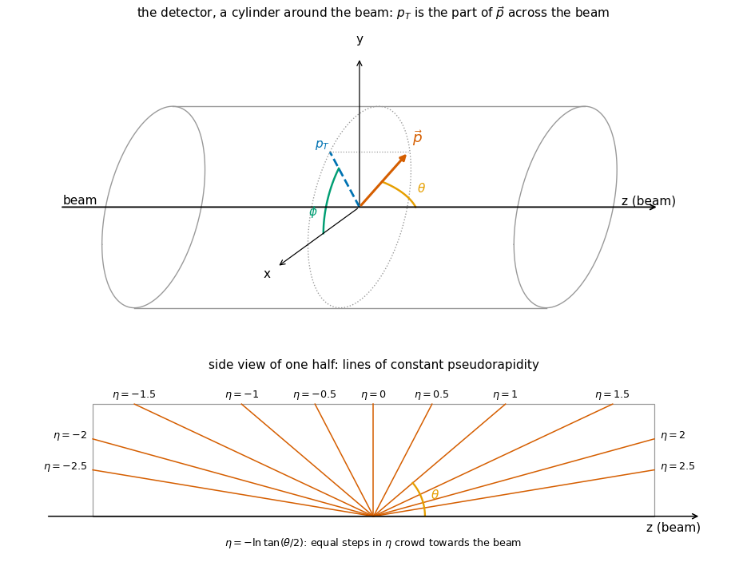
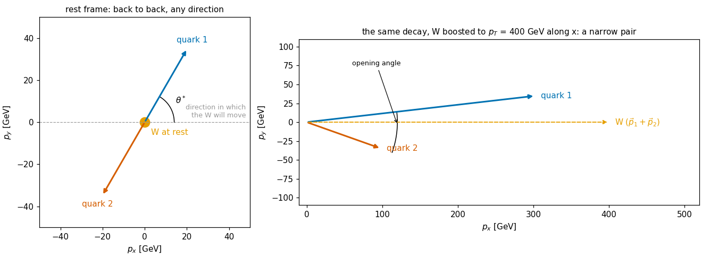
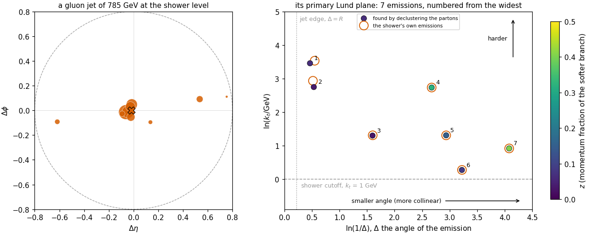
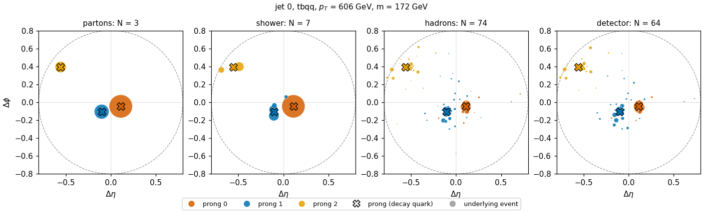

# Jets from zero

This primer is the first unit of the course. Starting from first-year physics, it explains what a jet is, where its
particles come from, and what the course's simplified simulation, the toy **A Spray of Hadrons**, stores about them. It
assumes mechanics, energy and momentum, and $E = mc^2$ with its companion $E^2 = p^2c^2 + m^2c^4$. It assumes no
special relativity beyond that, no particle physics and no statistics beyond a mean. The one Lorentz transformation (the
rule that converts energies and momenta between two observers in relative motion) that the course uses is given in a
box in section 2.

**How to read it.** Read it in pieces, each just before the question of task `W1.1` that uses it (the table below).
Every section takes 5-20 minutes and ends with two or three *Check yourself* questions. Their answers are at the end,
collapsed until you open them. The worked examples are in [notebooks/00_primer.ipynb](../notebooks/00_primer.ipynb):
they apply each tool to a different jet from the one in the questions. For depth, every section points to
[physics.md](physics.md) (the physics of the toy) or [observables.md](observables.md) (the observables, the numbers
computed from the particles of a jet). The [glossary](glossary.md) lists the terms.

| § | section | reading | read before |
|---|---|---|---|
| 1 | [Units and energies](#units-and-energies) | 5 min | `W1.1.1` |
| 2 | [Four-vectors and invariant mass](#four-vectors-and-invariant-mass) | 15 min | `W1.1.1` |
| 3 | [Collider coordinates](#collider-coordinates) | 20 min | `W1.1.2` |
| 4 | [The particles](#the-particles) | 15 min | `W1.1.3` |
| 5 | [What a jet is](#what-a-jet-is) | 10 min | `W1.1.3` |
| 6 | [Boosted W and top jets](#boosted-w-and-top-jets) | 10 min | `W1.1.3` |
| 7 | [The parton shower](#the-parton-shower) | 15 min | `W1.1.4` |
| 8 | [Hadronisation and the underlying event](#hadronisation-and-the-underlying-event) | 10 min | `W1.1.4` |
| 9 | [What a detector sees](#what-a-detector-sees) | 10 min | `W1.1.5` |
| 10 | [The toy and its files](#the-toy-and-its-files) | 15 min | `W1.1.5` (its paragraph *JetData* with `W1.1.1`, its truth table with `W1.1.4`) |
| 11 | [Histograms and errors](#histograms-and-errors) | 15 min | `W1.1.6` |
| 12 | [A first look at the observables](#a-first-look-at-the-observables) | 15 min | `W1.1.6` |
| 13 | [Where to read more](#where-to-read-more) | optional | |
| | [Check yourself: answers](#check-yourself-answers) | | |

## Units and energies

*Section 1, about 5 minutes.*

Particle physicists measure energy in **electronvolts**: 1 eV is the energy an electron gains across 1 volt, $1.6
\times 10^{-19}$ J. The energies of this course are in **GeV** ($10^9$ eV) and **TeV** ($10^{12}$ eV). Momenta and
masses are given in the same unit by setting the speed of light to one, $c = 1$. A momentum of 500 GeV then means
$p = 500\ \mathrm{GeV}/c$, and a mass of 80 GeV means $m = 80\ \mathrm{GeV}/c^2$. The relation of energy, momentum and
mass becomes

```math
E^2 = p^2 + m^2 .
```

A useful landmark: the proton has a mass of about 1 GeV (0.938 GeV).

Protons are not elementary. They are made of **quarks** and **gluons** (together: **partons**, section 4). The Large
Hadron Collider (LHC) at CERN, the European particle-physics laboratory, collides two beams of protons head on at a
total energy of 13 TeV. In a few of these collisions, two partons hit each other hard and fly apart with a large
momentum across the beam. Each of them becomes a **jet**, a narrow spray of particles (section 5).

The jets of this course carry a lot of momentum. The toy starts every jet from a quark, gluon, W or top (all introduced
in [The particles](#the-particles)). The momentum of this first particle across the beam (the $p_T$ of section 3) lies
between 450 and 1100 GeV. The number of jets falls steeply with $p_T$. Nine jets in ten of the toy files of weeks 1-3
lie between about 440 and 900 GeV (median about 540 GeV), and a few lie as far out as 200 GeV or 1.3 TeV. JetClass (a
large public set of simulated jets; see [jetclass.md](jetclass.md#the-data-set)) and the comparisons of week 4 use
500-1000 GeV. The particles of such a jet have energies from a fraction of a GeV to hundreds of GeV, far above their
masses. They move almost at the speed of light. The speed of a particle is $v/c = p/E$, which is already $0.99990$ for
a pion (the lightest hadron; $m = 0.14$ GeV) of 10 GeV.

**Check yourself.** (1a) What is the energy of a 1 TeV jet in joules, roughly, and is that a lot? (1b) Is a particle
with $E = 5$ GeV and $p = 3$ GeV possible, and what is its mass?

**Used in:** `W1.1.1`. **Read more:** [physics.md](physics.md#units-and-coordinates).

## Four-vectors and invariant mass

*Section 2, about 15 minutes.*

Energy and momentum belong together in a **four-vector**. The files of the course store it in the order

```math
p = (p_x, p_y, p_z, E)
```

as the columns `part_px`, `part_py`, `part_pz` and `part_energy`, all in GeV. Two observers who move relative to each
other measure different energies and momenta for the same particle, but they agree on one combination, the **invariant
mass**

```math
m^2 = E^2 - \lvert\vec p\rvert^2 = E^2 - p_x^2 - p_y^2 - p_z^2 .
```

This is $E^2 = p^2 + m^2$ of section 1 read the other way round. A **massless** particle (a photon, and to a very good
approximation every quark and gluon of a jet) has $E = \lvert\vec p\rvert$.

**The mass of a system.** Four-vectors add. The mass of a group of particles is the mass of their summed four-vector,
$P = p_1 + p_2 + \dots$, $M^2 = P_E^2 - \lvert\vec P\rvert^2$. If the group came from the decay of one particle, $M$ is
the mass of that particle. This holds whatever the decay products did afterwards, as long as none of them is missing.
It is why the mass of a jet is the first thing to look at when the jet might hold the decay of a W or a top.

**Two massless particles.** Let particle 1 have energy $E_1$, particle 2 energy $E_2$, and let $\theta$ be the angle
between their momenta. Then $\lvert\vec p_i\rvert = E_i$, and

```math
M^2 = (E_1 + E_2)^2 - \lvert\vec p_1 + \vec p_2\rvert^2
    = E_1^2 + 2E_1E_2 + E_2^2 - \bigl(E_1^2 + 2\vec p_1\cdot\vec p_2 + E_2^2\bigr)
    = 2E_1E_2\,(1 - \cos\theta) .
```

For a small angle, $1 - \cos\theta \approx \theta^2/2$, so

```math
M^2 \approx E_1E_2\,\theta^2 .
```

This small-angle form is the formula the course uses most. It ties the mass of a pair to the energies of its two
members and the angle between them.

> **Box: a boost along $z$.** A **boost** turns energies and momenta into those seen by an observer who moves with a
> constant velocity. An observer moving with the velocity $\beta$ (in units of $c$) along the $z$ axis sees the
> four-vector
>
> ```math
> E' = \gamma\,(E - \beta p_z), \qquad p_z' = \gamma\,(p_z - \beta E), \qquad p_x' = p_x, \qquad p_y' = p_y,
> \qquad \gamma = \frac{1}{\sqrt{1 - \beta^2}} .
> ```
>
> The mass does not change: $E'^2 - p_z'^2 = \gamma^2\bigl[(E - \beta p_z)^2 - (p_z - \beta E)^2\bigr] =
> \gamma^2(1 - \beta^2)(E^2 - p_z^2) = E^2 - p_z^2$, and $p_x$, $p_y$ are untouched. A boost in any other direction
> works the same way along that direction. This is the only Lorentz transformation the course needs. On a first reading, skip
> the rest of this box. `boost(p, beta)` in `itj.toy.kinematics` does the same with $\beta \to -\beta$, for arrays of
> four-vectors: it gives a particle at rest the velocity $\beta$. This shifts rapidities (see [Collider
> coordinates](#collider-coordinates)) by $+\mathrm{artanh}\,\beta$, where artanh is the inverse hyperbolic tangent.

**Check yourself.** (2a) Two massless particles of energy $E$ each fly apart back to back. What is their invariant
mass? And if they fly parallel? (2b) A particle of mass $M$ at rest decays into two massless particles. What is the
energy of each?

**Used in:** `W1.1.1`; again in `W1.1.3`, `W1.1.10`, `W1.3.1`. **Read more:**
[physics.md](physics.md#units-and-coordinates), [observables.md](observables.md#mass-and-multiplicity).

## Collider coordinates

*Section 3, about 20 minutes.*

<p align="center">
  
  <br>
  <em>The detector is a cylinder around the beam ($z$). A particle's momentum $\vec p$ has a part across the beam,
  $p_T$, at the azimuth $\phi$, and makes the polar angle $\theta$ with the beam. Below: lines of constant
  pseudorapidity $\eta$.</em>
</p>

The beams run along the $z$ axis; the collision point is the origin, and the detector is a cylinder around the beam.
The plane across the beam ($x$, $y$) is the **transverse plane**. A particle is described by

- its **transverse momentum** $p_T = \sqrt{p_x^2 + p_y^2}$, the part of its momentum across the beam;
- its **azimuth** $\phi$, the angle in the transverse plane, $\phi = \mathrm{arctan2}(p_y, p_x)$, between $-\pi$ and
  $\pi$;
- its **polar angle** $\theta$ to the beam, $\tan\theta = p_T/p_z$.

Why $p_T$? The two colliding partons each carry an unknown fraction of their proton's momentum, so the total momentum of
the collision along $z$ is unknown. Across the beam it is close to zero. Momentum across the beam can only come from the
hard collision (the violent hit of the two partons), which makes $p_T$ the natural measure of a jet.

**Rapidity.** Instead of $\theta$, physicists use the **rapidity**

```math
y = \frac{1}{2}\ln\frac{E + p_z}{E - p_z} ,
```

which is $0$ across the beam, positive towards $+z$ and negative towards $-z$, and grows in size towards the beam.
Rapidity is useful because of what a boost along the beam (the box of section 2) does to it. From the box,
$E' \pm p_z' = \gamma(1 \mp \beta)(E \pm p_z)$, so

```math
y' = y + \frac{1}{2}\ln\frac{1 - \beta}{1 + \beta} = y - \mathrm{artanh}\,\beta :
```

every rapidity shifts by the same constant. Differences of rapidity $\Delta y$ do not change, and neither do $p_T$ and
$\phi$. Since the collisions are boosted along the beam by an unknown amount, quantities built from $p_T$, $\Delta y$
and $\Delta\phi$ are the ones that mean the same in every collision.

**Pseudorapidity.** The **pseudorapidity** $\eta = -\ln\tan(\theta/2)$ depends only on the direction of a particle, not
on its energy. Detectors are built and described in $\eta$ for this reason. In the figure, $\eta = 0$ is across the
beam, and $\lvert\eta\rvert = 2.5$ is about 9.4° from it. For a massless particle $\eta = y$. In the plane of $\eta$ (or
$y$) and $\phi$ a particle is a point, and the distance of two particles is

```math
\Delta R = \sqrt{\Delta y^2 + \Delta\phi^2} ,
```

with $\Delta\phi$ **wrapped** into $(-\pi, \pi]$: $\phi$ is an angle, so $\phi = 3.1$ and $\phi = -3.1$ are close
neighbours, not $6.2$ apart. A jet covers a disc of radius $R$ in this plane (section 5).

**Coordinates relative to the jet.** The files also store where each particle sits relative to the jet axis (the
direction of the jet's summed momentum): `part_dphi` $= \mathrm{wrap}(\phi_i - \phi_\mathrm{jet})$ and `part_deta`
$= s\,(\eta_i - \eta_\mathrm{jet})$, in pseudorapidity, as in JetClass. The sign $s$ is $+1$ for jets with
$\eta_\mathrm{jet} \ge 0$ and $-1$ for jets with $\eta_\mathrm{jet} < 0$. JetClass mirrors jets in the backward half of
the detector (negative pseudorapidity) onto the forward half (positive pseudorapidity), and the toy does the same. Keep
this in mind whenever you compute a relative coordinate yourself.

**Check yourself.** (3a) Two particles have $\phi = 3.1$ and $\phi = -3.1$. What is their $\Delta\phi$? (3b) Why does
$\Delta y$ of two particles not change under a boost along the beam? (3c) At $\eta = 0$, how is the opening angle of
two nearby particles related to their $\Delta R$?

**Used in:** `W1.1.2`; again in `W1.1.3`, `W1.1.7`. **Read more:** [physics.md](physics.md#units-and-coordinates).

## The particles

*Section 4, about 15 minutes.*

**Quarks and gluons.** There are six **quarks**, and five of them matter here: up (u), down (d), strange (s), charm
(c) and bottom (b), each with its antiquark. The **gluon** carries the strong force between them, as the photon
carries the electromagnetic force. Quarks and gluons carry **colour**, the charge of the strong force. Unlike electric
charge, colour is never seen on its own: quarks and gluons are **confined** inside colour-neutral **hadrons**. The
strength of the strong force is the coupling $\alpha_s$, about 0.1 at the energies of a jet. It grows at lower
energies and is several times larger near 1 GeV. There the expansion in powers of $\alpha_s$ (perturbation theory,
which computes a process as a series of ever smaller corrections) stops working.

**The W boson and the top quark.** The W (80.4 GeV) carries the weak force, the force behind radioactive beta decay.
It lives for about $3 \times 10^{-25}$ s, far too short to fly any measurable distance. About two thirds of the time it
decays into a quark and an antiquark of another flavour ($\mathrm{W} \to q\bar q'$; the prime marks the
other flavour). Otherwise it decays into a charged lepton and a
neutrino (see *Leptons* below). An unstable particle has no single mass. Its masses spread around the nominal mass
with the bell-like shape of a **Breit-Wigner** distribution. The size of the spread is the **width** $\Gamma$, related
to the lifetime $\tau$ by $\Gamma \approx \hbar/\tau$ (for the W, $\Gamma = 2.1$ GeV and
$\tau \approx 3 \times 10^{-25}$ s). The toy draws the mass of each W and top from this shape and stores it as
`truth_mass`. The top quark (about 173 GeV; the toy uses 172.5 GeV) is the heaviest known particle. It decays before
it can form a hadron, almost always into a b quark and a W ($t \to bW$). The Z boson (91.2 GeV) is the W's neutral
partner (the primer notebook uses it). We never see a W or a top, only what they decay into.

**Hadrons** are the colour-neutral particles that quarks and gluons turn into (section 8). Most are **pions**
($\pi^\pm$, $\pi^0$); some are **kaons** (K), **protons** (p) and **neutrons** (n). The neutral pion decays at once
into two photons, $\pi^0 \to \gamma\gamma$. A b quark becomes a **B hadron**, which flies a few millimetres before it
decays. Sometimes that decay contains a charged lepton and a neutrino (a "semileptonic" decay). **Leptons** are the
particles that do not feel the strong force: electrons, muons and **neutrinos**. Neutrinos escape every detector
unseen.

| particle | mass [GeV] | charge | what the detector sees (section 9) |
|---|---|---|---|
| quarks u, d, s | below 0.1 | $+\frac23$ or $-\frac13$ | never alone: a jet |
| quarks c, b | about 1.3, about 4.8 | $+\frac23$, $-\frac13$ | a jet; a b gives a B hadron |
| gluon g | 0 | 0 | never alone: a jet |
| W, Z | 80.4, 91.2 | $\pm1$, 0 | only its decay products |
| top t | about 173 | $+\frac23$ | only its decay products (b and W) |
| $\pi^\pm$, $K^\pm$, p | 0.140, 0.494, 0.938 | $\pm1$ | a track, then energy in the hadronic calorimeter |
| $\pi^0$ | 0.135 | 0 | two photons |
| $K_L$ (long-lived neutral kaon), n | 0.498, 0.940 | 0 | energy in the hadronic calorimeter |
| photon $\gamma$ | 0 | 0 | energy in the electromagnetic calorimeter |
| electron e | 0.000511 | $-1$ | a track and energy in the electromagnetic calorimeter |
| muon $\mu$ | 0.106 | $-1$ | a track; it crosses the calorimeters |
| neutrino $\nu$ | about 0 | 0 | nothing |
| B hadron | about 5.3 | 0 or $\pm1$ | decays after a few mm: tracks that do not point back to the collision |

Charges are for the particle; its antiparticle has the opposite charge.

**Check yourself.** (4a) Which particles of the table leave a track? (4b) Why can a top jet lose part of its energy
without any detector failing?

**Used in:** `W1.1.3`; again in `W1.1.4`. **Read more:** [physics.md](physics.md#hard-process),
[physics.md](physics.md#hadronisation).

## What a jet is

*Section 5, about 10 minutes.*

A quark or gluon knocked out of a proton cannot fly away alone. It radiates more quarks and gluons (section 7), and
these turn into hadrons (section 8). Because the first quark or gluon moves so fast, all of them keep close to its
direction. What we see is a **jet**, a narrow spray of particles.

Which particles belong to which jet is a matter of definition. A **clustering algorithm** decides: it merges particles
pair by pair, and the jets are what is left. The algorithm used at the LHC and in this course is **anti-kT**. It always
merges first around the hardest particles (those with the most momentum across the beam). Every soft particle (one with
little momentum) is therefore gathered into the nearest hard core within the distance $R$. The jets come out as round
discs of radius $R$ in the $(y, \phi)$ plane, centred on their hard cores, and a soft particle does not change their
shape. This course uses $R = 0.8$, a "large-radius" jet, big enough to hold the decay products of a fast W or top. The
jet's four-vector is the sum of the four-vectors of its particles, so it has a $p_T$, a direction and a mass like any
particle.

Two kinds of jets matter here:

- **QCD jets** start from a single quark or gluon (QCD, quantum chromodynamics, is the theory of the strong force).
  They are by far the most common jets at the LHC. In every search for rarer jets they are the **background**, the
  common jets that the search must reject.
- **W jets** and **top jets** hold the decay products of one heavy particle. The toy and JetClass keep a W or top jet
  only if every decay quark ended up inside it (**containment**).

**Check yourself.** (5a) Why are anti-kT jets round? (5b) What is the mass of a jet that holds a single massless
particle?

**Used in:** `W1.1.3`; again in `W1.1.4`. **Read more:** [physics.md](physics.md#building-the-jet),
[observables.md](observables.md#clustering).

## Boosted W and top jets

*Section 6, about 10 minutes.*

<p align="center">
  
  <br>
  <em>A W decays into two quarks. At rest (left) they fly back to back, in any direction. Seen from the lab, where the
  W moves fast (right), both are thrown forward and the pair is narrow.</em>
</p>

At rest a W decays into two quarks that fly apart **back to back**, with equal and opposite momenta, in a random
direction. A W produced with a large $p_T$ is **boosted**: in the lab, both quarks move forward with it. The faster
the W, the smaller their opening angle. At high enough $p_T$ the two quarks land in one jet of $R = 0.8$, and the jet
has two hard clusters of energy, one per quark: its **prongs**.

The opening angle follows from section 2. Take a decay at $\eta = 0$, where each massless quark has $E \approx p_T$
and the opening angle of two nearby particles is their $\Delta R$ (section 3). If one quark carries the fraction $z$ of
the W's $p_T$ and the other $1 - z$, the small-angle mass becomes

```math
m^2 \approx z(1 - z)\,p_T^2\,\Delta R^2 .
```

A boost along the beam changes neither $m$, nor the $p_T$ of each quark, nor $\Delta R$, so this holds at every $\eta$.
Read the other way round, it tells how far apart the two prongs of a W jet are. In `W1.1.3` you derive the separation
for an even split, $z = 1/2$, and compare it with the toy.

A **top jet** has three prongs: the b quark and the two quarks of the W. The W inside it carries only part of the top's
$p_T$, so the same formula applies to it with its own $p_T$.

**Why it matters.** Searches for new heavy particles and measurements of the top, the W, the Z and the Higgs boson
(another heavy, unstable particle) at high energy look for exactly these jets. They are rare: QCD jets of the same
$p_T$ are far more common. **Tagging** means deciding, from the particles of a jet, which kind of particle started it.
A program that does this is a **tagger**, and taggers are the subject of this course.

**Check yourself.** (6a) Why does a W at rest decay into back-to-back quarks? (6b) In words: what happens to the
opening angle of the two quarks when the W moves faster?

**Used in:** `W1.1.3`; again in `W1.1.10`, `W1.4.2`. **Read more:** [physics.md](physics.md#hard-process).

## The parton shower

*Section 7, about 15 minutes.*

An accelerated electric charge radiates photons. A quark knocked hard out of a proton radiates gluons in the same way,
only more. The gluons radiate in turn and sometimes split into quark pairs. This cascade is the **parton shower**.
Every step is a **branching** $a \to bc$ (a quark into a quark and a gluon, a gluon into two gluons or into a
quark and an antiquark). Each emission has

- an **angle** $\theta$ to the emitter;
- a **momentum fraction** $z$, the share of the emitter's momentum that a daughter takes;
- a **transverse momentum** $k_t = z(1 - z)\,E\,\theta$ ($E$ the energy of the emitter), the momentum of the emission
  across its emitter's direction (not across the beam), and $k_t \approx zE\theta$ when $z$ is
  small.

**Soft and collinear.** For small angles and small momentum fractions the probability of one emission is about

```math
dP \approx \frac{2\alpha_s C_R}{\pi}\,\frac{d\theta}{\theta}\,\frac{dz}{z} ,
```

where $C_R$ is the colour factor of the emitter (below) and $z$ is the momentum fraction of the softer daughter.
Because of the $1/\theta$ and $1/z$, emissions are mostly **soft** (small $z$, little energy) and **collinear** (small
$\theta$, close to the emitter's direction). Halving $\theta$ (or $z$) adds as many emissions as the previous halving.
The **colour factor** $C_R$ is $C_F = 4/3$ for a quark and $C_A = 3$ for a gluon: a gluon radiates more than a quark.
The ratio of gluon to quark emissions is $C_A/C_F$ only for soft and collinear emissions. Hard splittings and
$g \to q\bar q$ make the real ratio of the numbers of emissions smaller. The toy's files store $z$ of the first daughter
instead of the softer one. It is close to 1 when a quark keeps most of its energy, so the soft fraction is
$\min(z, 1 - z)$.

**Order and end.** Successive emissions along a chain come at smaller and smaller angles; this is **angular
ordering**. From far away, a pair of partons looks like one colour charge. A soft gluon emitted at a
wider angle than the opening of the pair therefore sees only the total colour of the pair, as if the pair had not split.
This is **colour coherence**. The shower stops when $k_t$ falls to about 1 GeV in the toy (about 0.5 GeV in PYTHIA, a
widely used event generator: a program that simulates whole collisions). There $\alpha_s$ becomes large, and
hadronisation takes over (section 8).

<p align="center">
  
  <br>
  <em>One gluon jet at the shower level (left) and the map of its emissions, the primary Lund plane (right). Each filled
  point is one step of the declustering, numbered from the widest; the open circles are the emissions the shower
  actually made.</em>
</p>

**The Lund plane** (for the stretch question `W1.2.3` and for week 4: skip it on a first reading). The emissions of a
jet can be drawn as a map with one point per emission. The horizontal coordinate is $\ln(1/\Delta)$, with $\Delta$ the
emission's angle as found by undoing the clustering (see below), so collinear emissions lie to the right. The vertical
coordinate is $\ln k_t$, so hard emissions lie at the top. Since the probability above is flat in $\ln\theta$ and
$\ln z$, soft and collinear emissions are spread roughly evenly over this **Lund plane**. A measured jet does not list
its emissions, so they are found by undoing the clustering step by step. First the jet's particles are clustered again
by angle (the Cambridge/Aachen algorithm). Then the last merging is undone, the softer branch is recorded as an emission
at its $\Delta$ and $k_t$, and the harder branch is followed. This repeats down to a single particle. The emissions
found this way are the **primary** emissions: the ones emitted from the hardest chain.

**Check yourself.** (7a) Why is a soft emission likelier than a hard one? (7b) Which radiates more, a quark or a gluon?
(7c) A stored emission has $z = 0.97$. What is its soft fraction?

**Used in:** `W1.1.4`; again in `W1.1.8`, `W1.2.3`. **Read more:** [physics.md](physics.md#parton-shower),
[observables.md](observables.md#the-lund-plane).

## Hadronisation and the underlying event

*Section 8, about 10 minutes.*

**Hadronisation.** When the shower stops, near $k_t \approx 1$ GeV, the coupling is too large for the picture of single
emissions. Quarks and gluons now turn into colour-neutral hadrons (confinement, section 4). Nobody can compute this step
from first principles, so event generators use models. PYTHIA, which showered and hadronised the JetClass events,
stretches colour **strings** between partons and breaks them into hadrons. The toy uses the simpler **independent
fragmentation**: every parton starts its own chain of hadrons along its direction. Each hadron takes a fraction of the
remaining energy and a small sideways kick of a few hundred MeV (a few tenths of a GeV). Either way the hadrons follow
the partons' directions, and there are many more of them than partons.

**The underlying event.** A proton holds many partons. Besides the hard collision, other pairs of partons from the same
two protons collide softly. They add soft particles all over the detector, spread evenly in $y$ and $\phi$: the
**underlying event** (UE). A jet covers only the area $\pi R^2 \approx 2$ of the $(y, \phi)$ plane. In the toy a jet
holds one or two of these particles at the hadron level, fewer after the detector and often none. They come
from elsewhere in the collision, so they sit anywhere in the jet, unrelated to its prongs.

**Pileup** is different. At the LHC, several tens of proton-proton collisions happen in the same bunch crossing (one
pass of two bunches of protons through each other). Their particles overlap with those of the collision of interest.
Neither the toy nor JetClass has pileup.

**Check yourself.** (8a) Where in a jet does an underlying-event particle sit, and why may a jet hold none? (8b) Why
do hadrons follow the directions of the partons they come from?

**Used in:** `W1.1.4`; again in `W1.1.5`, `W1.3.3`. **Read more:** [physics.md](physics.md#hadronisation),
[physics.md](physics.md#underlying-event).

## What a detector sees

*Section 9, about 10 minutes.*

An LHC detector is built in layers around the beam, like an onion.

- The **tracker**, innermost, sits in a magnetic field. Charged particles leave hits along their path, the **track**,
  and the bend of the track gives their momentum. Very soft charged particles curl up and are lost, so tracks start
  above a threshold in $p_T$. A fraction of tracks is always missed. A track that does not point back to the collision
  point has a large **impact parameter** (its distance of closest approach to the collision point). Its particle came
  from a decay a few millimetres away, typically of a B hadron.
- A **calorimeter** is a block of dense material that stops particles and measures the energy they leave in it. The
  **electromagnetic calorimeter** (ECAL) stops photons and electrons and measures their energy.
- The **hadronic calorimeter** (HCAL) stops hadrons and measures the energy of the neutral ones ($K_L$, n) and of
  charged hadrons whose track was missed.
- Muons cross everything and are measured in the outermost layer; neutrinos cross everything unseen.

Calorimeters are divided into **cells**, small squares in $(\eta, \phi)$. The HCAL cells are much larger than the ECAL
cells. A cell reports one energy for everything that hit it, so nearby neutral particles **merge** into one. A cell
reports nothing below a **threshold**. Every energy is measured with a **resolution**, a random error that is
relatively smaller for larger energies. **Particle flow** combines tracks and cells into one list of particles: charged
particles from tracks, photons from ECAL cells, neutral hadrons from HCAL cells. This list is what JetClass, and the
`detector` level of the toy, store as the particles of a jet.

JetClass used **Delphes**, a fast simulation of the CMS (Compact Muon Solenoid) detector, one of the two large
general-purpose detectors at the LHC. Delphes applies efficiencies (the chance that a particle is seen), resolutions and
cells instead of following every particle through matter. The toy's detector is a cartoon of the same model; its
thresholds, cell sizes and resolutions are in [physics.md](physics.md#detector).

**Check yourself.** (9a) Which part of the detector sees a photon, which a $\pi^+$, and which neither? (9b) Two
photons hit the same ECAL cell. How many particles does the detector report, and with what energy?

**Used in:** `W1.1.5`; again in `W1.1.9`, `W4.1.1`. **Read more:** [physics.md](physics.md#detector),
[jetclass.md](jetclass.md#how-the-events-were-made).

## The toy and its files

*Section 10, about 15 minutes.*

<p align="center">
  
  <br>
  <em>One top jet at the four presets. Marker area: $p_T$; colour: the prong a particle comes from (grey for the
  underlying event); the crosses are the decay quarks.</em>
</p>

**The ladder.** The toy builds a jet in the steps of sections 4-9 and can stop after any of them. The four **presets**
(ready-made settings of the toy) form a ladder. `partons` holds only the quark or gluon of a QCD jet, or the decay
quarks of a W or top. `shower` adds the parton shower, and `hadrons` adds hadronisation, B-hadron decays and the
underlying event. `detector` adds the detector; it is the default and the only level calibrated to JetClass. Every jet
starts from a **seed parton**, the quark, gluon, W or top the toy starts the jet from (`truth_seed_pt` and related
columns). The name is used for the W and the top too, although they are not partons. The same random seed (the number
that starts the toy's random-number generator) gives the same hard events at every preset. Files made with one random
seed are **paired samples**: jet $i$ of one file and jet $i$ of another are the same event at two levels. Their
difference shows what one step does.

**JetData.** In Python a file is a `JetData` object: one row per jet. Jet columns (`jet_*`, `label_*`, many `truth_*`)
hold one number per jet. Particle columns (`part_*`, `truth_part_*`) hold one number per particle, sorted by $p_T$,
hardest first. Jets have different numbers of particles, so these columns are **ragged**: they are stored as one long
array plus the place where each jet starts. For calculations, `padded_p4()` turns the particles into rectangular arrays:

- `p4` of the shape (jets, particles, 4), the four-vectors $(p_x, p_y, p_z, E)$, filled with zeros after the last
  particle of a jet (**padding**);
- `mask` of the shape (jets, particles), true for the real particles and false for the padding.

Because the padding is zeros, a sum of four-vectors over all particles is already right. For anything else (a mean, a
minimum, a logarithm), use the mask. A padded array of a big file does not fit comfortably in memory, so walk the file
in pieces: `for chunk in data.chunks(2000):` reads it 2 000 jets at a time.

```python
import itj.toy

jets = itj.toy.show_ladder("tbqq", seed=5)  # one top jet at the four presets: a dict of JetData
p4, mask = jets["partons"].padded_p4()
print(p4.shape, mask.shape)  # (1, 3, 4) and (1, 3): one jet, three decay quarks
```

**What a tagger may see.** The columns of JetClass (`part_*`, `jet_*`, `label_*`, `aux_*`) are what a real detector
or a real data set provides. A tagger reads only `part_*` and `jet_*`. The labels say which process made the jet
(`label_QCD`, `label_Wqq`, `label_Tbqq`; `data.process_names` gives "qcd", "wqq" or "tbqq"). The `truth_*` columns hold
what only a simulation knows (the prongs, every emission, the origin of every particle). Real data has no such
columns; in the toy they let you check every claim. Never give them to a tagger.

The JetClass columns of week 1 ([data_format.md](data_format.md#jetclass-branches) has all of them):

| column | one per | content |
|---|---|---|
| `part_px`, `part_py`, `part_pz`, `part_energy` | particle | the four-vector [GeV] |
| `part_deta`, `part_dphi` | particle | the position relative to the jet axis (section 3) |
| `jet_pt`, `jet_eta` | jet | of the summed four-vector (also `jet_phi`, `jet_energy`) |
| `jet_nparticles` | jet | the number of particles $N$ |
| `jet_sdmass` | jet | the soft-drop mass $m_\mathrm{SD}$ [GeV] (section 12) |
| `jet_tau1`, `jet_tau2`, `jet_tau3` | jet | N-subjettiness $\tau_1$, $\tau_2$, $\tau_3$ (section 12) |
| `label_QCD`, `label_Wqq`, `label_Tbqq` | jet | 1 for the process that made the jet |

The other `label_*` columns are JetClass classes that the toy never makes (always 0). The `aux_*` columns hold the
seed parton as the event generator made it ($p_T$, $\eta$, $\phi$, particle code). The truth columns of week 1
([data_format.md](data_format.md#truth-branches)):

| column | one per | content |
|---|---|---|
| `truth_event_id` | jet | the event number: equal in paired files |
| `truth_seed_pt` | jet | $p_T$ of the seed parton [GeV] |
| `truth_mass` | jet | the W or top mass the toy drew for this jet [GeV]; 0 for QCD |
| `truth_dr_min` | jet | the smallest $\Delta R$ between the decay quarks; NaN for QCD |
| `truth_part_prong` | particle | the prong a particle comes from; $-1$ for the underlying event |
| `truth_part_is_ue` | particle | 1 for an underlying-event particle |

**What the toy leaves out.** It is a toy: one jet per event, no radiation before the hard collision, no pileup,
independent fragmentation instead of strings, a simple detector with perfect particle flow. It is good enough to make
jets whose observables resemble those of JetClass at the `detector` level, and simple enough to know the truth of
every particle. [physics.md](physics.md#what-the-toy-leaves-out) lists the simplifications.

**Check yourself.** (10a) Which columns may a tagger use? (10b) `p4` has the shape (3000, 140, 4). How many jets are
there, and what does `mask[0].sum()` count? (10c) Why can two paired files not be pooled as if they were independent?

**Used in:** `W1.1.5`; again in `W1.2.1`, `W1.3.1`. **Read more:** [data_format.md](data_format.md),
[physics.md](physics.md#presets), [physics.md](physics.md#reproducibility).

## Histograms and errors

*Section 11, about 15 minutes.*

**Histograms.** A histogram counts the entries $n_k$ that fall into each bin $k$. To compare samples of different
sizes, draw a **normalised density**: divide by the number of entries $N$ and by the bin width $\Delta x_k$,

```math
f_k = \frac{n_k}{N\,\Delta x_k} , \qquad \sum_k f_k\,\Delta x_k = 1 ,
```

so that the area under the histogram is 1 and its height is "entries per unit of $x$", whatever the binning.

**The error of a bin.** A count of random events fluctuates: if a bin expects $\nu$ entries, the count scatters by
about $\sqrt\nu$ (the **Poisson error**), estimated by $\sqrt{n_k}$. So 100 entries are known to 10 %, 10 000 to 1 %.
The error of a density is that of its count, scaled the same way: $\sigma_{f_k} = \sqrt{n_k}/(N\,\Delta x_k)$. Draw it
as an error bar.

**Means and ratios.** The mean of $N$ values with the spread (standard deviation) $\sigma$ has the error
$\sigma/\sqrt N$. More data shrinks the error, but slowly. For a ratio $r = a/b$ of two independent means, the
relative errors add in quadrature (their squares add):

```math
\left(\frac{\sigma_r}{r}\right)^2 = \left(\frac{\sigma_a}{a}\right)^2 + \left(\frac{\sigma_b}{b}\right)^2 .
```

**Cumulative distributions and log axes.** The cumulative distribution, the fraction of entries below $x$, needs no
bins and shows tails and medians well. When values span several orders of magnitude, use a log axis. For a histogram
of such values, use log bins (`np.geomspace`), which have equal widths in $\ln x$.

**A good figure** (the checklist of TASKS in short) has axis labels with units, a legend and a caption that says
what is shown (level, process, number of jets). It has error bars where they matter and a log axis where values span
orders of magnitude.

**Check yourself.** (11a) A bin holds 100 entries. What is its error? (11b) The histogram holds 10 000 jets in bins
of 5 GeV; what are the density of that bin and its error? (11c) Why does the error of a mean shrink like $1/\sqrt N$
and not like $1/N$?

**Used in:** `W1.1.6`; again in `W1.2.1`, `W1.2.5`. **Read more:** the
[figure checklist of TASKS](../TASKS.md#what-to-hand-in).

## A first look at the observables

*Section 12, about 15 minutes.*

An **observable** is a number computed from the particles of a jet. Week 1 uses five. Their formulas are in
[observables.md](observables.md).

- **The jet mass** $m$, the mass of the summed four-vector (section 2). For a W or top jet it reflects the mass of the
  decaying particle. For a QCD jet it comes from the spread of its radiation.
- **Grooming and soft drop.** **Grooming** removes soft radiation at wide angles from a jet, including particles of the
  underlying event. Such radiation carries little information about the hard process but adds mass. **Soft drop** is one
  grooming method. It first regroups the particles of the jet pair by pair, closest in angle first. It then undoes that
  grouping one merge at a time, starting from the widest. At each step, the softer branch is dropped if it carries less
  than a fraction $z_\mathrm{cut} = 0.1$ of the $p_T$ of the pair. Soft drop stops at the first branching where the
  softer branch carries at least this fraction. What remains is the hard core; its mass is the **soft-drop mass**
  $m_\mathrm{SD}$ (`jet_sdmass`).
- **N-subjettiness** $\tau_N$ measures how well $N$ axes describe the jet. It sums the $p_T$ of every particle times
  its distance to the nearest of $N$ axes, so it is small when every particle sits close to one of them. A jet with two
  prongs is described much better by two axes than by one, so a small **$\tau_{21}$** $= \tau_2/\tau_1$ indicates two
  prongs.
- **Energy correlation functions** sum over pairs ($e_2$) and triples ($e_3$) of particles, weighted by their momentum
  fractions and their angles. Their ratio **$D_2$** $= e_3/e_2^3$ is small for two prongs.
- **The multiplicity** $N$, the number of particles in the jet (`jet_nparticles`).

**Which observables can be trusted?** Soft and collinear emissions are everywhere (section 7). How many of them a jet
has depends on details nobody controls: the shower cutoff, hadronisation, the detector thresholds. An observable that a
theorist can compute, and that small changes of these details do not upset, must pass two tests. It must not change
when a very soft particle is added (**infrared safety**). It must also not change when one particle is replaced by two
collinear ones that share its momentum (**collinear safety**). Together: **IRC safe** (infrared and collinear safe).
An observable that fails either test is **IRC unsafe**. Some observables are not IRC safe but can still be computed,
because the shower rarely makes the jets on
which they fail. They are called **Sudakov safe**. Which observable
is which is a question of week 3.

**Check yourself.** (12a) In one sentence: what does $\tau_{21}$ measure? (12b) What does soft drop remove first?
(12c) A detector merges two photons in one cell into one particle. Which of the two tests does that touch?

**Used in:** `W1.1.6`; again in `W1.3.2`, `W1.4.1`, `W3.3.1`. **Read more:**
[observables.md](observables.md#soft-drop), [observables.md](observables.md#n-subjettiness),
[observables.md](observables.md#energy-correlation-functions); [observables.md](observables.md#irc-safety) after
`W3.3.2`.

## Where to read more

*Section 13, optional.*

- **The course docs.** [physics.md](physics.md): the toy's hard process, shower, hadronisation, underlying event,
  detector and the leading-log results, with derivations. [observables.md](observables.md): every observable of the
  course and IRC safety. [data_format.md](data_format.md): every column.
- **G. P. Salam**, *Towards jetography*, Eur. Phys. J. C 67 (2010) 637, arXiv:0906.1833, chapters 1-2: what a jet is,
  and how jet algorithms work.
- **S. Marzani, G. Soyez and M. Spannowsky**, *Looking inside jets*, Lecture Notes in Physics 958, Springer (2019),
  arXiv:1901.10342, chapters 1-3: QCD and jets for beginners, then boosted objects.
- **A. J. Larkoski, I. Moult and B. Nachman**, *Jet substructure at the Large Hadron Collider*, Phys. Rept. 841 (2020)
  1, arXiv:1709.04464, section 2: the observables of this course in one review.
- **Particle Data Group**, the review *Kinematics* (pdg.lbl.gov): four-vectors, boosts and rapidity on a few pages.

The reading list of the course is in [references.md](references.md#reading-list).

## Check yourself: answers

<details>
<summary>1. Units and energies</summary>

(1a) $10^{12} \times 1.6 \times 10^{-19}$ J $= 1.6 \times 10^{-7}$ J: about the kinetic energy of a flying mosquito,
tiny in everyday terms but enormous for one particle. (1b) Yes: $m^2 = E^2 - p^2 = 25 - 9 = 16$, so $m = 4$ GeV. A
particle needs $E \ge p$.

</details>

<details>
<summary>2. Four-vectors and invariant mass</summary>

(2a) Back to back: $\theta = \pi$, $M^2 = 2E^2(1 - \cos\pi) = 4E^2$, $M = 2E$ (all the energy goes into mass, as for a
particle at rest that decays). Parallel: $\theta = 0$, $M = 0$. (2b) $M/2$ each: the momenta add to zero, so they are
equal and opposite, $\lvert\vec p_1\rvert = \lvert\vec p_2\rvert = p$; massless means $E_1 = E_2 = p$, and energy
conservation gives $2p = M$.

</details>

<details>
<summary>3. Collider coordinates</summary>

(3a) $3.1 - (-3.1) = 6.2$, wrapped by subtracting $2\pi$: $-0.083$, so the two particles are $0.083$ apart in $\phi$.
(3b) A boost along the beam shifts every rapidity by the same constant, which cancels in a difference. (3c) They are
equal for small angles: at $\eta = 0$ the directions are across the beam, where a small step in $y$ and a small step in
$\phi$ are both angles.

</details>

<details>
<summary>4. The particles</summary>

(4a) The charged ones: $\pi^\pm$, $K^\pm$, protons, electrons and muons. (4b) Its b quark becomes a B hadron, whose
decay can produce a neutrino, and the neutrino escapes unseen.

</details>

<details>
<summary>5. What a jet is</summary>

(5a) Anti-kT merges around the hardest particles first, so each jet grows outwards from a hard core until it reaches the
radius $R$; soft particles do not pull the boundary. (5b) Zero: the mass of one massless particle.

</details>

<details>
<summary>6. Boosted W and top jets</summary>

(6a) At rest the W has no momentum, and momentum is conserved: the two quark momenta must add to zero, so they are equal
and opposite. (6b) It shrinks: the faster the W, the more both quarks are thrown forward along its direction.

</details>

<details>
<summary>7. The parton shower</summary>

(7a) The probability grows like $dz/z$ at small $z$. Every factor of two in $z$ is equally likely, so there is far
more room for soft emissions than for hard ones. (7b) A gluon: its colour factor $C_A = 3$ is larger than the quark's
$C_F = 4/3$. (7c) $\min(0.97, 0.03) = 0.03$.

</details>

<details>
<summary>8. Hadronisation and the underlying event</summary>

(8a) Anywhere: the underlying event is spread evenly over the detector, unrelated to the jet. A jet covers only a small
area, so on average it collects few of these particles, often none. (8b) The hadrons get only small sideways kicks
(a few hundred MeV) compared with their energies along the parton (GeV to hundreds of GeV). Their angle to the parton
is therefore small.

</details>

<details>
<summary>9. What a detector sees</summary>

(9a) A photon: the electromagnetic calorimeter. A $\pi^+$: the tracker, and the hadronic calorimeter if its track is
missed. Neither: a neutrino. (9b) One photon, with (about, after the resolution) the summed energy of the two, if
that energy passes the threshold of the cell.

</details>

<details>
<summary>10. The toy and its files</summary>

(10a) `part_*` and `jet_*`; never `truth_*` (and the labels are the answer the tagger is trained on, not an input).
(10b) 3 000 jets, padded to 140 particles, the length of the longest jet; `mask[0].sum()` counts the real particles of
the first jet. (10c) Paired files hold the same events, so they are not independent: their fluctuations are shared.
They are made for differences.

</details>

<details>
<summary>11. Histograms and errors</summary>

(11a) $\sqrt{100} = 10$, 10 %. (11b) $100/(10\,000 \times 5\ \mathrm{GeV}) = 0.002$ per GeV, with the error
$10/(10\,000 \times 5\ \mathrm{GeV}) = 0.0002$ per GeV. (11c) Random fluctuations of independent values partly cancel
in a sum: the spread of a sum of $N$ values grows like $\sqrt N$, so that of their mean like $\sqrt N/N = 1/\sqrt N$.

</details>

<details>
<summary>12. A first look at the observables</summary>

(12a) How much better two axes describe the jet than one: small means two prongs. (12b) Soft branches at wide angles,
because it undoes the clustering from the widest angle inwards. (12c) Collinear safety: two collinear particles become
one.

</details>
